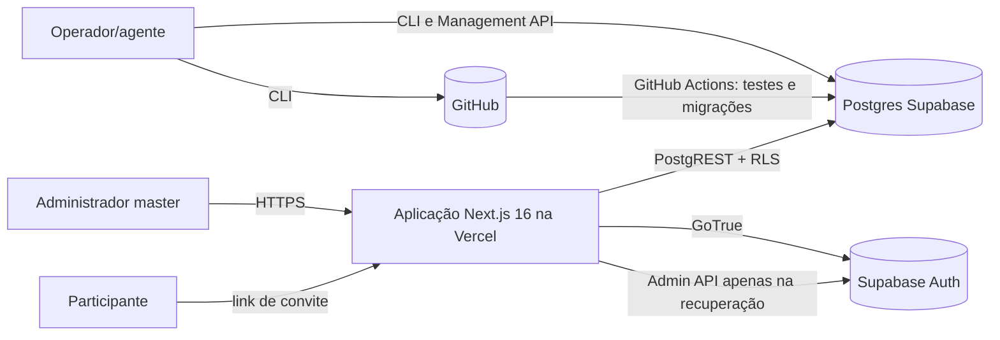
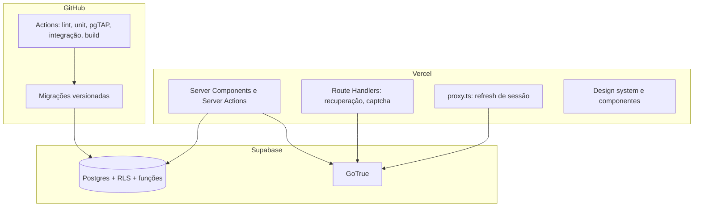
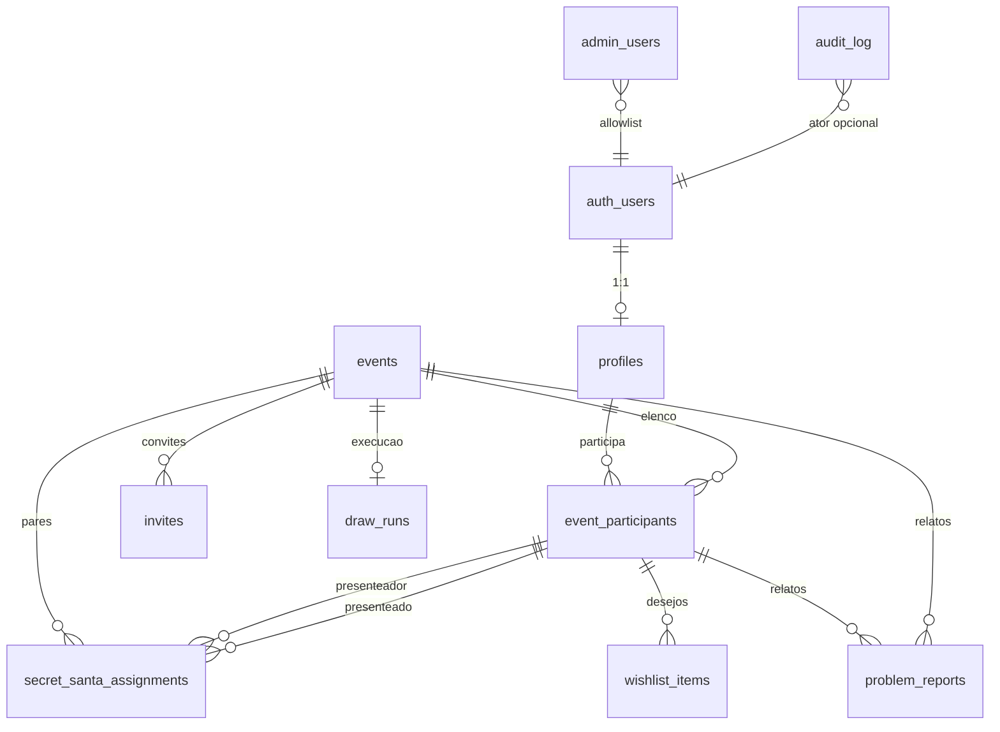
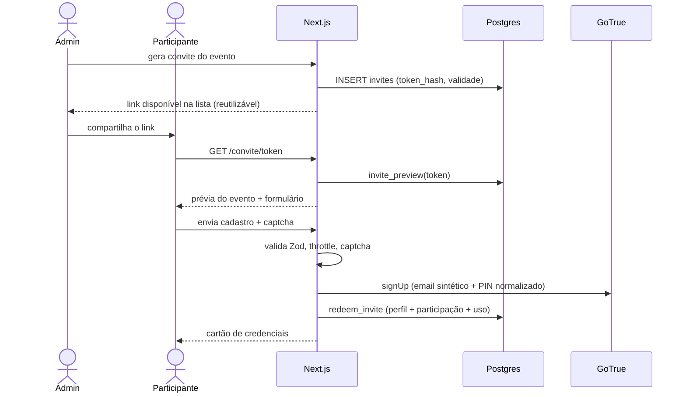

# confConf — Plataforma de Confraternizações e Amigo Secreto

## Plano de Implementação — Fase 1 (Planejamento e Definição da Arquitetura)

| Campo | Valor |
|---|---|
| Versão do documento | 1.1 |
| Data | 2026-11-14 |
| Repositório | `github.com/LeicsonBP/confConf` (público) |
| Stack aprovada | Next.js 16 + TypeScript + Supabase |
| Ambientes | Local, Teste, Produção |
| Status | Fase 1 concluída — Fase 2 aguarda início no marco M0 |
| Aprovação | Cliente (Leicson), em 2026-11-14 |

> **Rastreabilidade.** Este documento substitui o briefing de entrada como fonte de verdade do projeto. O briefing original está preservado no primeiro commit (`docs: registra briefing de entrada`). A única exigência **revogada** é a de §3.3 ("o administrador NÃO pode visualizar nenhum resultado"), substituída pela decisão **D-05**. Todas as demais exigências foram atendidas ou explicitamente adaptadas na seção 4.

### Índice

- [0. Registro de decisões](#0-registro-de-decisões)
- [1. Sumário executivo](#1-sumário-executivo)
- [2. Briefing, premissas e alterações de escopo](#2-briefing-premissas-e-alterações-de-escopo)
- [3. Análise funcional](#3-análise-funcional)
- [4. Matriz de rastreabilidade](#4-matriz-de-rastreabilidade)
- [5. Lacunas e decisões abertas](#5-lacunas-e-decisões-abertas)
- [6. Arquitetura](#6-arquitetura)
- [7. Stack: comparativos e decisão](#7-stack-comparativos-e-decisão)
- [8. Banco de dados](#8-banco-de-dados)
- [9. Autenticação e autorização](#9-autenticação-e-autorização)
- [10. Segurança e privacidade](#10-segurança-e-privacidade)
- [11. Fluxos críticos](#11-fluxos-críticos)
- [12. UI/UX e identidade visual](#12-uiux-e-identidade-visual)
- [13. Repositório e padrões de código](#13-repositório-e-padrões-de-código)
- [14. Estratégia de testes](#14-estratégia-de-testes)
- [15. Ambientes, Git, CI/CD e runbook](#15-ambientes-git-cicd-e-runbook)
- [16. Operação assistida por agente](#16-operação-assistida-por-agente)
- [17. Documentação e ADRs](#17-documentação-e-adrs)
- [18. Roadmap da Fase 2](#18-roadmap-da-fase-2)
- [19. Critérios de aceite](#19-critérios-de-aceite)
- [20. Riscos e aceites explícitos](#20-riscos-e-aceites-explícitos)
- [21. Pré-requisitos e ações do cliente](#21-pré-requisitos-e-ações-do-cliente)
- [22. Anexos](#22-anexos)

---

## 0. Registro de decisões

Convenção de identificadores usada em todo o documento: `D-` decisão, `REQ-` exigência do briefing, `UC-` caso de uso, `BR-` regra de negócio, `O-` decisão aberta, `R-` risco, `AC-` critério de aceite, `ADR-` registro de decisão arquitetural (criado na Fase 2).

| ID | Decisão | Origem | Impacto |
|---|---|---|---|
| D-01 | Frontend **Next.js 16 (App Router) + TypeScript strict** | Cliente | Define renderização, roteamento e integração com Supabase |
| D-02 | Identidade visual **"ingresso/talão retrô"** | Cliente | Design system próprio, cartão de credenciais como canhoto |
| D-03 | **PIN numérico de 4 a 8 dígitos** | Cliente | Normalização para 6 caracteres antes do GoTrue; throttle próprio |
| D-04 | Recuperação por **identificador + data de nascimento** | Cliente | Endpoint com captcha, limite rígido e auditoria; risco residual aceito |
| D-05 | **Admin PODE visualizar o sorteio**, oculto por padrão com ícone de olho | Cliente | Revoga §3.3 do briefing; simplifica RLS e remove MFA obrigatório do desenho |
| D-06 | **Captcha aritmético próprio** (soma/subtração assinada) | Cliente | Sem dependência de Cloudflare/hCaptcha; exige throttle no servidor |
| D-07 | **Vercel importada manualmente pelo cliente**; Supabase e GitHub operados pelo agente | Cliente | Guia de deploy documentado; automação limitada ao Supabase e ao repositório |
| D-08 | Planos **gratuitos** (Supabase Free, Vercel Hobby) e **sem domínio próprio** por enquanto | Cliente | URLs `*.vercel.app`; limitações de pausa/backup documentadas |
| D-09 | Repositório permanece **público** | Cliente | CI ilimitado; rigor absoluto com segredos e dados fictícios |
| D-10 | Tokens colados no chat e **rotacionados ao final do setup** | Cliente | Tokens ficam no histórico da conversa; rotação obrigatória |
| D-11 | Sem Edge Functions; lógica privilegiada em funções SQL `security definer` | Técnica | Menos superfície, transações atômicas, um único uso de `service_role` |
| D-12 | Fluxo Git com `main` (produção) e `develop` (teste), merges só após CI verde | Cliente | Nenhum deploy de produção sem passar pelo ambiente de teste |
| D-13 | `service_role` restrita ao endpoint de recuperação de credenciais | Técnica | Contenção da chave mais poderosa do sistema |
| D-14 | **Ambiente único**: um projeto Supabase (`confConf`) e trabalho direto na branch `main`, sem `develop` | Cliente (2026-11-14) | Revoga D-12; CI valida migrações no Supabase local antes de cada push |
| D-15 | **Link de convite reutilizável e sempre visível** ao admin (usos ilimitados por padrão); token guardado cifrado | Cliente (2026-11-14) | Revoga o "uso único/uma exibição"; ver ADR-0009 |
| D-16 | **Usuário do participante = primeiro nome normalizado + 3 dígitos** (ex.: `leicson745`), sem símbolos, acentos ou hífen | Cliente (2026-11-14) | Sub­stitui o identificador baseado no nome completo; identificadores antigos continuam válidos |
| D-17 | **Endereço completo do evento** como campo opcional, exibido aos convidados junto com o local | Cliente (2026-11-14) | Novo campo em `events.address`, sem alterar o `location` |
| D-18 | **Participante pertence a uma única confraternização**; a área do participante abre direto o evento, sem tela de seleção | Cliente (2026-11-14) | `/app` redireciona para o evento do participante |
| D-19 | **Nome completo imutável no perfil** do participante; a edição se restringe às restrições alimentares | Cliente (2026-11-14) | Ajuste em BR-31 e na tela de perfil |
| D-20 | Administrador pode **desfazer o sorteio** e **sortear de novo** (para incluir/remover participantes) | Cliente (2026-11-14) | Ajusta BR-15/BR-33; desfazer apaga pares e confirmações |
| D-21 | **Recuperação de usuário** com senha + data de nascimento, reexibindo as credenciais e a opção de baixar as informações | Cliente (2026-11-14) | Novo endpoint `/api/recuperacao/usuario`; complementa a recuperação de senha |
| D-22 | **Data prevista do sorteio** no cadastro da confraternização (opcional, só com amigo secreto), exibida ao participante | Cliente (2026-11-14) | Novo campo `events.draw_scheduled_at` |

---

## 1. Sumário executivo

O confConf é uma aplicação web para organizar confraternizações e amigos secretos. Ela tem dois portais: um **administrativo**, com usuário master único, e um **portal do participante**, acessível apenas por link de convite.

A aplicação é um monólito **Next.js 16** na Vercel com **Supabase** (Postgres + Auth) como banco e autenticação. A segurança não depende da interface: o banco aplica RLS em todas as tabelas, o sorteio roda em uma função transacional no Postgres e o participante só consegue ler o próprio par do sorteio. O administrador vê o resultado completo no painel, mas apenas sob ação explícita (ícone de olho), com os dados carregados sob demanda.

O participante não tem e-mail: entra com um **identificador** gerado a partir do nome (`maria-silva-482`) e um **PIN numérico de 4 a 8 dígitos**, recebendo um **cartão de credenciais** na hora do cadastro. O cadastro é protegido por convite, captcha aritmético e limite de tentativas.

O planejamento alimentar é calculado a partir do número de participantes e das restrições declaradas, sempre apresentado como **estimativa em faixas**, nunca como ordem de compra.

O desenvolvimento segue **M0 a M7**, com testes unitários obrigatórios, testes de RLS no banco, testes de integração no CI e E2E da jornada completa. Por decisão do cliente (**D-14**), existe **um único ambiente**: o projeto Supabase `confConf` e a branch `main`. A validação de banco acontece no Supabase local dentro do CI antes de cada push.

**O que falta do cliente:** informar os dois tokens (GitHub e Supabase) e importar o projeto na Vercel quando o código amadurecer. O restante do provisionamento é executado pelo agente (seção 16).

---

## 2. Briefing, premissas e alterações de escopo

### 2.1 Exigências mantidas

Todas as exigências de §2, §3.1, §3.2, §4, §5 e §6 do briefing foram mantidas, com adaptações pontuais indicadas na matriz de rastreabilidade (seção 4). A stack de hospedagem (Vercel), banco/backend (Supabase) e versionamento (GitHub) está confirmada; o projeto Supabase único (`confConf`) foi configurado no M0.

### 2.2 Alterações de escopo aprovadas

| Alteração | Substitui | Consequência |
|---|---|---|
| D-05 — admin pode ver o sorteio | §3.3 do briefing | A privacidade deixa de ser "o admin nunca vê" e passa a ser: participante vê só o seu; admin vê sob clique no olho; o dado não é enviado na carga inicial da página |
| D-06 — captcha aritmético próprio | "capcha simples" do briefing | Sem conta externa; combina com throttle no servidor; é uma trava anti-bot de primeira camada, não uma prova de humanidade forte |
| D-07 — Vercel importada pelo cliente | Provisionamento integral pelo agente | Guia passo a passo documentado; CI do repositório continua autônomo |
| D-03 — PIN 4 a 8 dígitos | "senha numérica de até 6 dígitos" | Atende o texto do briefing e a configuração do GoTrue via normalização |
| D-10 — tokens no chat | Boas práticas de gestão de segredos | Rotação obrigatória ao final do setup |
| D-14 — ambiente único | Separação teste/produção (D-12) | Sem banco de teste separado; CI valida local; deploy direto da `main` |

### 2.3 Premissas

1. Idioma único **pt-BR**; strings centralizadas para futura tradução.
2. Fuso **America/Sao_Paulo** como padrão de exibição; datas armazenadas em UTC.
3. Moeda **BRL**; valores monetários em centavos.
4. **Sem e-mail transacional**: participantes usam e-mail sintético não entregável; nenhuma notificação por e-mail na v1.
5. **Sem upload de arquivos**: lista de desejos aceita texto e links `http(s)`.
6. **Sem pagamentos**: o valor máximo do presente é informativo.
7. Interface **mobile-first** (participantes abrem no celular).
8. Uma única pessoa administra o sistema (operador único).
9. Acesso do participante é sempre por convite; não existe autorregistro aberto.
10. O sorteio é **irreversível** na v1 (não há "refazer").

### 2.4 Status do projeto

- Fase 1: **concluída** com este documento.
- Fase 2: **não iniciada**; começa no M0 após o cliente fornecer os tokens e aprovar o início.

---

## 3. Análise funcional

### 3.1 Atores

| Ator | Descrição | Autenticação |
|---|---|---|
| **Administrador master** | Pessoa única que cria eventos, convida participantes, configura e executa o sorteio | Usuário e senha master, criados fora da aplicação |
| **Participante** | Convidado de um evento, com conta própria e acesso restrito ao próprio conteúdo | Identificador + PIN, sessão por cookie |
| **Visitante com convite** | Pessoa que abriu um link válido e ainda não tem conta | Token do convite (efêmero) |
| **Anônimo** | Qualquer acesso sem sessão e sem convite | Nenhuma |
| **Operador/agente** | Executa provisionamento, migrações e deploys | Acesso administrativo de CLI |

### 3.2 Contextos de uso

| Contexto | Rota base | Público |
|---|---|---|
| Portal público | `/`, `/convite/[token]`, `/entrar`, `/recuperar`, `/privacidade` | Anônimo |
| Portal do participante | `/app/*` | Autenticado como participante |
| Portal administrativo | `/admin/*` | Autenticado como admin |
| Showcase de design (somente dev) | `/design` | Desenvolvimento |

### 3.3 Inventário de casos de uso

**Administrativo**

| ID | Caso de uso | Regras | Prioridade |
|---|---|---|---|
| UC-01 | Entrar no portal administrativo | BR-01, BR-02 | Must |
| UC-02 | Criar evento | BR-03, BR-04 | Must |
| UC-03 | Editar evento | BR-03, BR-16 | Must |
| UC-04 | Excluir evento | BR-26 | Must |
| UC-05 | Listar e filtrar eventos | — | Must |
| UC-06 | Gerar link de convite | BR-05, BR-06 | Must |
| UC-07 | Listar, revogar e recriar convites | BR-06 | Must |
| UC-08 | Listar participantes de um evento | BR-31 | Must |
| UC-09 | Remover participante | BR-25 | Must |
| UC-10 | Ver restrições alimentares consolidadas | BR-18, BR-19 | Must |
| UC-11 | Calcular planejamento alimentar | BR-19, BR-20 | Should |
| UC-12 | Executar o sorteio | BR-12 a BR-17 | Must |
| UC-13 | Acompanhar confirmações do sorteio | BR-17 | Should |
| UC-14 | Revelar o resultado do sorteio (olho) | BR-11, D-05 | Must |
| UC-15 | Tratar relatos de problema | BR-24 | Should |
| UC-16 | Cadastrar-se como participante de um evento | BR-09 | Should |
| UC-17 | Consultar a trilha de auditoria | — | Could |
| UC-18 | Sair da sessão | — | Must |

**Participante**

| ID | Caso de uso | Regras | Prioridade |
|---|---|---|---|
| UC-19 | Abrir convite e ver prévia do evento | BR-05, BR-06 | Must |
| UC-20 | Cadastrar-se pelo convite | BR-07 a BR-10, BR-35 | Must |
| UC-21 | Receber e guardar o cartão de credenciais | BR-08, BR-13 | Must |
| UC-22 | Entrar com identificador e PIN | BR-08, BR-27 | Must |
| UC-23 | Recuperar acesso | BR-28, BR-29 | Must |
| UC-24 | Listar os eventos de que participa | BR-10 | Must |
| UC-25 | Ver detalhes de um evento | BR-10 | Must |
| UC-26 | Ver o próprio amigo secreto | BR-11, BR-12 | Must |
| UC-27 | Confirmar o recebimento do sorteio | BR-17 | Must |
| UC-28 | Gerenciar a própria lista de desejos | BR-22 | Must |
| UC-29 | Ver a lista de desejos do amigo sorteado | BR-23 | Must |
| UC-30 | Relatar um problema | BR-24 | Should |
| UC-31 | Editar nome e restrições alimentares | BR-31, BR-18 | Should |
| UC-32 | Sair da sessão | — | Must |

**Serviços internos**

| ID | Serviço | Regras |
|---|---|---|
| UC-33 | Sortear pares sem ponto fixo (derangement) | BR-12 a BR-15 |
| UC-34 | Calcular estimativas alimentares | BR-19, BR-20 |
| UC-35 | Aplicar throttle e captcha | BR-36 a BR-38 |

### 3.4 Regras de negócio

| ID | Regra |
|---|---|
| BR-01 | Existe **um único** administrador master, sem cadastro público e sem criação de novas contas administrativas pela interface |
| BR-02 | A conta do administrador é criada por script de operação, com senha forte e rotação trimestral recomendada |
| BR-03 | O evento exige nome (3–120 caracteres) e data/hora; descrição, local, **endereço completo**, valor máximo do presente e informações adicionais são opcionais |
| BR-04 | O amigo secreto é **opcional por evento**; o evento existe e funciona sem sorteio |
| BR-05 | Só é possível cadastrar-se com um convite válido, não expirado e não revogado |
| BR-06 | O convite tem validade padrão de 30 dias, usos configuráveis (**ilimitado por padrão**, para compartilhar em grupo) e pode ser revogado a qualquer momento; o admin vê o link sempre que quiser |
| BR-07 | O identificador de usuário é o **primeiro nome** normalizado (sem acentos, minúsculas, sem símbolos) seguido de exatamente 3 dígitos aleatórios; é único e imutável |
| BR-08 | O PIN tem 4 a 8 dígitos numéricos; é normalizado com zeros à esquerda até 6 caracteres para o Supabase Auth; nunca é exibido ao administrador |
| BR-09 | Cada participante tem e-mail sintético não entregável derivado do identificador; não há envio de e-mail no sistema |
| BR-10 | Um participante pode participar de vários eventos com a mesma conta |
| BR-11 | O participante vê exclusivamente o par sorteado para ele |
| BR-12 | O administrador vê o resultado do sorteio somente sob ação explícita (olho), carregado sob demanda |
| BR-13 | O sorteio exige ao menos 2 participantes ativos |
| BR-14 | É impossível um participante sortear a si mesmo |
| BR-15 | O sorteio pode ser **desfeito e refeito** pelo administrador; desfazer apaga pares e confirmações e reabre o elenco |
| BR-16 | Após o sorteio, o elenco fica congelado e o amigo secreto não pode ser desativado |
| BR-17 | A confirmação do sorteio é opcional, idempotente e visível ao administrador como contagem |
| BR-18 | Restrições alimentares: vegetariano, vegano, sem lactose, sem glúten e outra (com descrição livre de até 300 caracteres) |
| BR-19 | Vegano implica vegetariano; nas contagens, o vegano é contado uma única vez |
| BR-20 | Planejamento alimentar é apresentado como estimativa em faixas, com premissas explícitas |
| BR-21 | O valor máximo do presente é informativo e aparece como orientação na lista de desejos |
| BR-22 | Item da lista de desejos exige título (1–120 caracteres); link é opcional e precisa ser `http(s)` |
| BR-23 | A lista de desejos é visível ao dono e ao participante sorteado para ele, **depois** do sorteio; nunca ao administrador |
| BR-24 | Relato de problema é categorizado (`recebi_eu_mesmo`, `nao_recebi`, `outro`), com mensagem de 10 a 2000 caracteres, e pode ser resolvido pelo admin |
| BR-25 | Após o sorteio, participantes não podem ser removidos nem adicionados; antes do sorteio o administrador pode remover um participante (remoção física, com registro em auditoria) |
| BR-26 | Excluir um evento remove em cascata participantes, convites, pares, listas e relatos após confirmação digitada |
| BR-27 | Falhas de login não revelam se a conta existe |
| BR-28 | Recuperação de senha exige usuário e data de nascimento corretos, mais captcha e limite de tentativas |
| BR-39 | Recuperação de usuário exige senha e data de nascimento corretos; ao confirmar, o sistema exibe o usuário e permite baixar as informações de acesso novamente |
| BR-40 | O evento com amigo secreto pode ter uma **data prevista do sorteio** (opcional), exibida na área do participante até o sorteio acontecer |
| BR-29 | Após a recuperação, todas as sessões do participante são revogadas |
| BR-30 | Todo texto exibido é pt-BR; datas no fuso do evento; valores em BRL |
| BR-31 | O participante edita apenas as próprias restrições alimentares (nome, usuário e data de nascimento são imutáveis); o admin não edita dados do participante, apenas remove |
| BR-32 | O sorteio usa gerador criptográfico e algoritmo documentado e versionado |
| BR-33 | Refazer o sorteio só é possível após **desfazer**; não existe histórico de sorteios anteriores (cada execução substitui a anterior) |
| BR-34 | Um participante removido antes do sorteio pode ser convidado novamente por novo link |
| BR-35 | O identificador é imutável após o cadastro; a data de nascimento também |
| BR-36 | Login, cadastro, recuperação e prévia de convite têm limite de tentativas por identificador e por IP |
| BR-37 | O captcha é obrigatório em cadastro, login (participante e admin) e recuperação |
| BR-38 | Nenhum dado pessoal é gravado em log de aplicação |

### 3.5 Modelo de domínio

As entidades e regras ficam em `src/modules/<domínio>/domain/*`, como classes com invariantes (atende ao requisito de orientação a objetos "quando aplicável"), sem dependência de Next.js ou Supabase.

| Classe | Responsabilidade | Invariantes |
|---|---|---|
| `Identifier` | Gerar e validar identificadores | Formato `^[a-z0-9-]{2,40}-[0-9]{3}$`; imutável |
| `PinPolicy` | Validar e normalizar PINs | 4 a 8 dígitos; normalização com zeros à esquerda até 6 |
| `Event` | Dados e ciclo do evento | Nome obrigatório; `hasSecretSanta` congelado após sorteio |
| `Participant` | Participação em um evento | Pertence a um evento; restrições válidas; sem duplicidade por usuário |
| `Invite` | Token e ciclo de vida | Expirado, revogado ou esgotado = inválido |
| `DrawRun` | Metadados de execução | Um por evento; imutável |
| `Derangement` | Algoritmo puro de sorteio | Sem ponto fixo; uniforme sobre os derangements; testável isoladamente |
| `WishlistItem` | Item de desejos | Título obrigatório; URL válida ou ausente |
| `ProblemReport` | Relato | Categoria válida; texto no intervalo |
| `ArithmeticChallenge` | Captcha | Assinatura HMAC válida; expiração de 10 minutos; resposta única |
| `Throttle` | Limite de tentativas | Janela deslizante; bloqueio progressivo |
| `FoodEstimate` | Estimativas | Determinístico; faixas; sem contagem dupla de vegano |

---

## 4. Matriz de rastreabilidade

`Situação`: **A** = atendido, **A/A** = atendido com adaptação, **R** = revogado pelo cliente.

| REQ | Origem | Exigência | Cobertura | AC | Situação |
|---|---|---|---|---|---|
| REQ-01 | §3.1 | Acesso admin exclusivo por usuário e senha master, sem cadastro público | UC-01, BR-01, BR-02 | AC-01 | A |
| REQ-02 | §3.1 | CRUD de confraternizações com os 8 campos descritos | UC-02 a UC-05, BR-03, BR-04 | AC-02, AC-03 | A |
| REQ-03 | §3.1 | Geração e compartilhamento de links de convite | UC-06, UC-07, BR-05, BR-06 | AC-04 | A |
| REQ-04 | §3.1 | Gerenciamento de participantes por evento | UC-08, UC-09, BR-31 | AC-05 | A |
| REQ-05 | §3.1 | Visão consolidada de restrições alimentares | UC-10, BR-18, BR-19 | AC-06 | A |
| REQ-06 | §3.1 | Planejamento alimentar com estimativas | UC-11, UC-34, BR-20 | AC-07 | A |
| REQ-07 | §3.1 | Administrador também participa como usuário comum | UC-16, BR-09 | AC-08 | A |
| REQ-08 | §3.2 | Acesso do participante exclusivamente por convite | UC-19, UC-20, BR-05 | AC-09 | A |
| REQ-09 | §3.2 | Cadastro com nome completo, nascimento, PIN numérico, restrições e captcha | UC-20, BR-07, BR-08, BR-18, BR-37 | AC-10 | A/A (PIN 4–8 por D-03) |
| REQ-10 | §3.2 | Identificador automático com 3 dígitos e tratamento de duplicidade | UC-20, BR-07 | AC-11 | A |
| REQ-11 | §3.2 | Plataforma fornece as credenciais ao participante | UC-21, BR-08 | AC-12 | A |
| REQ-12 | §3.2 | Área individual: consulta às confraternizações | UC-24, BR-10 | AC-13 | A |
| REQ-13 | §3.2 | Visualização das informações do evento | UC-25 | AC-13 | A |
| REQ-14 | §3.2 | Consulta exclusiva ao próprio resultado do sorteio | UC-26, BR-11 | AC-14 | A |
| REQ-15 | §3.2 | Lista de desejos com adicionar, editar e remover | UC-28, BR-22 | AC-15 | A |
| REQ-16 | §3.2 | Confirmação do sorteio | UC-27, BR-17 | AC-16 | A |
| REQ-17 | §3.2 | Botão e modal para relatar problema | UC-30, BR-24 | AC-17 | A |
| REQ-18 | §3.3 | Amigo secreto opcional por evento | BR-04 | AC-02 | A |
| REQ-19 | §3.3 | Sorteio iniciado e executado pelo administrador | UC-12 | AC-18 | A |
| REQ-20 | §3.3 | Distribuição aleatória realizada pela plataforma | UC-33, BR-32 | AC-19 | A |
| REQ-21 | §3.3 | Cada participante vê apenas a pessoa sorteada para ele | UC-26, BR-11 | AC-14 | A |
| REQ-22 | §3.3 | **Administrador não pode visualizar nenhum resultado** | UC-14 + D-05 | AC-20 | **R** (D-05) |
| REQ-23 | §3.3 | Sorteio com mínimo de 2 participantes e sem auto-sorteio | UC-12, BR-13, BR-14 | AC-18, AC-19 | A |
| REQ-24 | §3.3 | Restrição garantida pela arquitetura e pelas regras do banco | RLS + funções | AC-21 | A/A (garante isolamento entre participantes) |
| REQ-25 | §3.3 | Participante pode confirmar o sorteio | UC-27, BR-17 | AC-16 | A |
| REQ-26 | §4 | Arquitetura com separação de responsabilidades e modularidade | Seção 6 | AC-30 | A |
| REQ-27 | §4 | Orientação a objetos quando aplicável | Seção 3.5 | AC-30 | A |
| REQ-28 | §4 | Código limpo, legível, reutilizável, nomenclatura padronizada | Seção 13 | AC-31 | A |
| REQ-29 | §4 | Tratamento consistente de erros em todas as camadas | Seção 6.7 | AC-32 | A |
| REQ-30 | §4 | Segurança por arquitetura e políticas de banco | Seção 10 | AC-21, AC-33 | A |
| REQ-31 | §4 | Testes unitários obrigatórios e integração quando pertinente | Seção 14 | AC-34 | A |
| REQ-32 | §4 | Documentação contínua e versionada | Seção 17 | AC-35 | A |
| REQ-33 | §4 | UI/UX diferenciada, moderna, intuitiva e performática | Seção 12 | AC-36 | A |
| REQ-34 | §4 | Manutenibilidade e evolução | Seções 6, 13 | AC-30 | A |
| REQ-35 | §5.1 | Rotina de 8 verificações antes de concluir qualquer alteração | Seção 14.9 | AC-37 | A |
| REQ-36 | §5.2 | Documentação no repositório mais comentários no código | Seção 17 | AC-35 | A |
| REQ-37 | §6 | Nenhuma decisão relevante sem aprovação explícita | Seções 0, 5 | AC-38 | A |
| REQ-38 | §7 | Definição das credenciais master | UC-01, BR-02 | AC-01 | A |
| REQ-39 | §7 | Escolha do framework frontend com comparativo | Seção 7 | AC-39 | A |
| REQ-40 | §7 | Estratégia de autenticação | Seção 9 | AC-01, AC-10 | A |
| REQ-41 | §7 | Política de RLS | Seção 10.3 | AC-21 | A/A (escopo reduzido por D-05) |
| REQ-42 | §7 | Expiração e revogação de convites | UC-06, UC-07, BR-06 | AC-04 | A |
| REQ-43 | §7 | Modelo de identidade visual | Seção 12 | AC-36 | A |
| REQ-44 | §7 | Critérios de aceite por funcionalidade | Seção 19 | AC-01 a AC-40 | A |
| REQ-45 | §8 | Os 11 entregáveis da Fase 1 | Este documento | AC-40 | A |
| REQ-46 | §8 | Fase 2 incremental com testes e ADRs | Seções 17, 18 | AC-35, AC-37 | A |
| REQ-47 | §2.2 | Comparativo de frameworks com 7 critérios | Seção 7.2 | AC-39 | A |
| REQ-48 | Pedido do cliente | Ambientes de teste e produção com uso correto de branches | Seção 15 | AC-41 | **R** (D-14) |
| REQ-49 | Pedido do cliente | Provisionamento de Supabase e do repositório executado pelo agente | Seção 16 | AC-42 | A |
| REQ-50 | Pedido do cliente | Vercel importada pelo cliente com documentação de apoio | Seções 15.8, 16 | AC-42 | A |

---

## 5. Lacunas e decisões abertas

Nenhuma delas bloqueia o M0. Todas têm recomendação técnica e serão confirmadas no marco indicado.

| ID | Ponto em aberto | Recomendação | Confirmar em |
|---|---|---|---|
| O-01 | MFA/TOTP para o administrador | Adotar no M6 (o admin agora vê o sorteio, então proteger a conta ganhou peso; mas não bloqueia o MVP) | M6 |
| O-02 | Migrar para Supabase Pro na produção | Sim, na virada para produção: Free pausa após inatividade e não tem backup | M7 |
| O-03 | Domínio próprio | Opcional; `*.vercel.app` atende o MVP | M7 |
| O-04 | "Refazer sorteio" | Não implementar; criar novo evento | M4 |
| O-05 | Idade mínima para participação | Sem restrição técnica; responsabilidade do organizador, informada nos termos | M1 |
| O-06 | Exclusão de evento | Exigir digitação do nome do evento antes de excluir | M1 |
| O-07 | Admin vê listas de desejos? | Não; apenas o dono e o amigo sorteado | M3 |
| O-08 | Participante vê a lista de outros participantes? | Não na v1; só o próprio par do sorteio | M3 |
| O-09 | Exportar planejamento alimentar | Impressão via CSS (sem CSV) na v1 | M5 |
| O-10 | Notificações | Nenhuma na v1 (sem e-mail) | M6 |
| O-11 | Parâmetros das estimativas alimentares | Revisar valores com o cliente no M5 antes de fechar | M5 |
| O-12 | Backup/restauração | Depende do plano Supabase (O-02); documentar runbook | M7 |

---

## 6. Arquitetura

### 6.1 Princípios

1. **O banco é a última linha de defesa**: RLS habilitada em todas as tabelas, nenhuma tabela acessível por padrão.
2. **Uma fonte de verdade por regra**: regra de negócio vive no domínio; restrição de acesso vive no banco; validação de entrada é compartilhada (Zod) entre cliente e servidor.
3. **Privilégio mínimo**: `service_role` só no endpoint de recuperação; nenhuma chave secreta no cliente.
4. **Transações no banco**: sorteio, cadastro por convite e consumo de convite são atômicos.
5. **Renderização no servidor por padrão** (React Server Components); JavaScript no cliente apenas onde há interação.
6. **Fronteiras explícitas**: `domain` não conhece `infrastructure`; módulos não importam a `infrastructure` de outro módulo.
7. **Erros tipados**: nenhuma exceção crua cruza a fronteira HTTP.
8. **Sem otimização prematura**: sem Edge Functions, sem ORM, sem cache distribuído na v1.
9. **Documentação no mesmo commit do código**.
10. **Tudo automatizável é automatizado**: migrações, testes, provisionamento e validação.

### 6.2 Visão de contexto



### 6.3 Visão de contêineres



### 6.4 Camadas e módulos

```
src/
├── app/                        # rotas (App Router)
├── modules/
│   ├── auth/                   # identificador, PIN, sessão, captcha, throttle
│   ├── events/                 # CRUD e ciclo do evento
│   ├── invites/                # geração, validação e consumo de convites
│   ├── participants/           # cadastro, perfil, restrições
│   ├── draw/                   # regras do sorteio e leitura do resultado
│   ├── wishlist/
│   ├── food-planning/
│   ├── reports/
│   └── audit/
├── lib/supabase/               # client, server, admin (service_role)
├── lib/crypto/                 # HMAC, hashing de tokens, RNG
├── design-system/              # tokens, primitivas e componentes visuais
├── shared/                     # erros, validação (Zod), formatação, i18n
└── proxy.ts
```

Cada módulo tem as camadas `domain/`, `application/`, `infrastructure/` e `presentation/`. A regra de dependência é unidirecional: `presentation → application → domain`; `infrastructure` implementa interfaces definidas em `application` ou `domain`.

### 6.5 Sessão e autorização

1. `proxy.ts` (equivalente ao middleware no Next.js 16) renova o cookie de sessão a cada requisição e redireciona rotas protegidas.
2. Componentes de servidor usam o cliente Supabase com cookies (`@supabase/ssr`) e validam a sessão com `getUser()`, nunca confiando apenas no cookie.
3. O portal administrativo exige `am_i_admin()`; o portal do participante exige linha em `profiles`.
4. Toda decisão de autorização de dados fica na RLS. A UI só esconde o que o banco já bloqueia.
5. Logout revoga a sessão no Supabase e limpa cookies.

### 6.6 Fronteiras de confiança

| Fronteira | O que cruza | Controle |
|---|---|---|
| Navegador → aplicação | Formulários, links de convite, resposta do captcha | Zod, captcha, throttle, origem/CSRF |
| Aplicação → Postgres | Sessão do usuário (JWT) | RLS; `security definer` só onde necessário |
| Aplicação → GoTrue Admin | Troca de PIN na recuperação | `service_role` em um único endpoint, `server-only`, auditoria |
| GitHub Actions → Supabase | Migrações e testes | Tokens em Secrets; ambiente separado por projeto |
| Agente/CLI → Supabase | Provisionamento | Token de conta; arquivo de segredos fora do git |

### 6.7 Erros, logging e observabilidade

- `AppError` com `code`, `message` (pt-BR), `httpStatus` e `cause` opcional; domínio retorna `Result<T, E>`.
- Mapeamento único em `shared/errors`: código desconhecido vira 500 com mensagem genérica; nada de stack trace para o usuário.
- Logs estruturados (JSON) com `requestId`, rota, código de erro e identificadores internos — **sem** nome, data de nascimento, PIN ou token.
- `error.tsx` e `not-found.tsx` por segmento; `loading.tsx` com skeletons.
- Observabilidade na v1: logs da Vercel + `audit_log` do banco. Sentry fica para o M6 se houver necessidade.

### 6.8 Renderização e desempenho

- RSC por padrão; `use client` apenas em formulários interativos, "olho" do sorteio, modais e toasts.
- Server Actions para mutações; Route Handlers apenas para recuperação, captcha e healthcheck.
- Sem biblioteca de estado global na v1.
- Meta: LCP < 2,5 s em 4G, bundle inicial < 180 KB gzip por rota, sem layout shift.
- Fontes via `next/font` (self-hosted, sem requisição a terceiros).

---

## 7. Stack: comparativos e decisão

### 7.1 Critérios e pesos

| Critério | Peso |
|---|---|
| Compatibilidade com Vercel + Supabase | 20% |
| Flexibilidade visual e personalização | 15% |
| Experiência de desenvolvimento | 15% |
| Desempenho | 15% |
| Facilidade de manutenção | 15% |
| Escalabilidade | 10% |
| Integração com ferramentas de IA | 10% |

### 7.2 Comparativo de frameworks

Notas de 0 a 5, ponderadas pelos pesos acima. Versões estáveis consideradas: Next.js 16.x, SvelteKit 3.x, Astro 6.x, Nuxt 4.x (versões exatas fixadas no M0).

| Critério (peso) | Next.js 16 | SvelteKit 3 | Astro 6 | Nuxt 4 |
|---|---|---|---|---|
| Vercel + Supabase (20%) | 5 | 3 | 4 | 2 |
| Flexibilidade visual (15%) | 5 | 5 | 5 | 5 |
| Experiência de dev (15%) | 4 | 5 | 3 | 4 |
| Desempenho (15%) | 4 | 5 | 5 | 4 |
| Manutenção (15%) | 4 | 4 | 4 | 4 |
| Escalabilidade (10%) | 5 | 4 | 3 | 4 |
| Integração com IA (10%) | 5 | 3 | 3 | 3 |
| **Total ponderado** | **4,55** | **4,15** | **3,95** | **3,65** |

**Next.js 16 (escolhido).** Prós: integração oficial com Supabase via `@supabase/ssr`, deploy nativo na Vercel, maior ecossistema, ferramental de IA maduro, experiência prévia do cliente. Contras: curva de aprendizado de RSC/Server Actions, mais conceitos simultâneos, bundle maior que concorrentes.

**SvelteKit 3.** Prós: melhor DX do grupo, bundle mínimo, ótima performance. Contras: ecossistema menor de exemplos para IA, integração SSR com Supabase mais manual, menos gente disponível para manter.

**Astro 6.** Prós: excelente para páginas públicas e SEO, performance de topo. Contras: este projeto é um app autenticado com muita interação; ilhas exigem costura manual e mais decisões por tela.

**Nuxt 4.** Prós: ótima DX, Vue é produtivo. Contras: suporte SSR ao Supabase menos maduro, integração com Vercel inferior ao Next.js.

### 7.3 Decisão

**Next.js 16 + TypeScript strict**, com App Router, React Server Components e Server Actions.

### 7.4 Estilo e design system

- **Tailwind CSS v4** como camada utilitária sobre tokens próprios em CSS custom properties (`src/design-system/tokens.css`), com `@theme` mapeando cores, tipografia, espaçamento, raios e sombras.
- **Sem shadcn/ui e sem tema pronto**: componentes são escritos no projeto, com a identidade da seção 12.
- **Primitivas headless (Radix)** apenas para Dialog, Select, Toast e Tooltip — acessibilidade sem impor aparência.
- Nenhuma biblioteca de ícones "genérica" como fonte de personalidade; ícones desenhados em SVG quando fizer sentido.

### 7.5 Bibliotecas de apoio

| Necessidade | Escolha | Motivo |
|---|---|---|
| Validação | Zod | Schemas compartilhados cliente/servidor |
| Formulários | React Hook Form + Zod | Baixo custo de render, boa ergonomia |
| Datas | `Intl` + utilitários próprios | Sem dependência extra; fuso do evento explícito |
| Testes unitários | Vitest | Rápido, integra com o ecossistema Next |
| Componentes | Testing Library + jsdom | Padrão da comunidade |
| E2E | Playwright | Multi-browser, trace, captura de falhas |
| Testes de banco | pgTAP via `supabase test db` | Prova a RLS no nível do banco |
| Lint/format | ESLint 9 (flat) + Prettier | Padrão único no CI |
| Banco | Supabase CLI | Migrações, tipos, testes locais no CI |
| Gerenciador de pacotes | npm | Já instalado; sem etapa extra de ambiente |

### 7.6 Descartado e por quê

| Alternativa | Motivo do descarte |
|---|---|
| Edge Functions | A lógica privilegiada cabe em funções SQL; menos deploys, transação atômica |
| ORM (Prisma/Drizzle) | RLS e funções SQL são o centro do desenho; ORM adicionaria camada sem ganho |
| Biblioteca de componentes pronta | Contraria o requisito de identidade própria |
| hCaptcha/Turnstile | Risco de fricção de configuração e acessibilidade; o cliente pediu captcha simples próprio |
| Storybook | O showcase interno `/design` cobre a necessidade na v1 |

---

## 8. Banco de dados

### 8.1 Convenções

- Schemas: `public` (exposto, com RLS) e `private` (helpers e throttle, não exposto).
- Nomes em `snake_case` no banco; `camelCase` no TypeScript (tipos gerados).
- Chaves primárias `uuid` com `gen_random_uuid()`; `bigserial` apenas em log.
- Datas em `timestamptz` (UTC); fuso de exibição vem do evento.
- `created_at`/`updated_at` com trigger de atualização.
- Exclusão lógica (`removed_at`) para participantes; cascata física apenas ao excluir o evento.
- Enums do Postgres para valores fechados (restrições, categorias, status de relato).
- Toda tabela nasce com `ALTER TABLE ... ENABLE ROW LEVEL SECURITY` e sem políticas permissivas; acesso é concedido por política explícita.

### 8.2 Diagrama entidade-relacionamento



### 8.3 Tabelas

**`public.profiles`** — identidade do participante.

| Coluna | Tipo | Restrições |
|---|---|---|
| `id` | uuid | PK, FK `auth.users(id)` on delete cascade |
| `username` | text | not null, unique, check `^[a-z0-9-]{4,44}$` (novos usuários: primeiro nome + 3 dígitos) |
| `full_name` | text | not null, 2 a 120 caracteres |
| `birth_date` | date | not null, entre 1900-01-01 e hoje |
| `created_at` / `updated_at` | timestamptz | not null, default now() |

Índices: `profiles_username_key` (único). `username` e `birth_date` são imutáveis (trigger `trg_profiles_immutable`).

**`public.admin_users`** — allowlist de administradores.

| Coluna | Tipo | Restrições |
|---|---|---|
| `user_id` | uuid | PK, FK `auth.users(id)` on delete cascade |
| `created_at` | timestamptz | not null |
| `note` | text | até 200 caracteres |

Sem políticas para `authenticated`; leitura apenas por `private.is_admin()` (security definer). Inserção apenas por `public.bootstrap_admin`, executável só por `service_role`.

**`public.events`** — a confraternização.

| Coluna | Tipo | Restrições |
|---|---|---|
| `id` | uuid | PK, default `gen_random_uuid()` |
| `name` | text | not null, 3 a 120 caracteres |
| `description` | text | até 2000 caracteres |
| `location` | text | até 200 caracteres |
| `address` | text | até 300 caracteres; endereço completo exibido aos convidados |
| `starts_at` | timestamptz | not null |
| `draw_scheduled_at` | timestamptz | nulo; data prevista do sorteio (só com amigo secreto) |
| `timezone` | text | not null, default `America/Sao_Paulo` |
| `max_gift_cents` | integer | nulo ou 0 a 100.000.000 |
| `extra_info` | text | até 2000 caracteres |
| `has_secret_santa` | boolean | not null, default true |
| `created_by` | uuid | FK `auth.users(id)` |
| `created_at` / `updated_at` | timestamptz | not null |

Índice: `events_starts_at_idx`. O status do evento é derivado (`draw_runs` + `starts_at`), sem coluna redundante.

**`public.event_participants`** — vínculo pessoa × evento.

| Coluna | Tipo | Restrições |
|---|---|---|
| `id` | uuid | PK |
| `event_id` | uuid | FK `events(id)` on delete cascade |
| `user_id` | uuid | FK `auth.users(id)` on delete cascade |
| `dietary_restrictions` | `dietary_restriction[]` | not null, default `{}` |
| `dietary_other` | text | até 300 caracteres |
| `confirmed_draw_at` | timestamptz | nulo |
| `removed_at` | timestamptz | nulo |
| `joined_at` | timestamptz | not null, default now() |

Único: `(event_id, user_id)`. Índices: `event_id`, `user_id`.
`dietary_restriction` = enum(`vegetariano`, `vegano`, `sem_lactose`, `sem_gluten`, `outra`).

**`public.invites`** — links de convite.

| Coluna | Tipo | Restrições |
|---|---|---|
| `id` | uuid | PK |
| `event_id` | uuid | FK `events(id)` on delete cascade |
| `token_hash` | text | not null, unique (SHA-256 hexadecimal do token) |
| `token_ciphertext` | text | nulo; token cifrado (AES-256-GCM) para o admin reexibir o link |
| `label` | text | até 80 caracteres |
| `expires_at` | timestamptz | not null, default now() + 30 dias |
| `max_uses` | integer | nulo = ilimitado; 1 a 5000 quando definido |
| `used_count` | integer | not null, default 0, >= 0 e <= `max_uses` |
| `revoked_at` | timestamptz | nulo |
| `created_by` | uuid | FK `auth.users(id)` |
| `created_at` / `last_used_at` | timestamptz | — |

O token em claro fica cifrado (AES-256-GCM com `APP_SECRET`) para o admin reexibir o link; a validação usa o hash SHA-256.

**`public.secret_santa_assignments`** — o resultado do sorteio.

| Coluna | Tipo | Restrições |
|---|---|---|
| `event_id` | uuid | FK `events(id)` on delete cascade |
| `giver_participant_id` | uuid | FK `event_participants(id)` on delete cascade |
| `receiver_participant_id` | uuid | FK `event_participants(id)` on delete cascade |
| `created_at` | timestamptz | not null |

PK `(event_id, giver_participant_id)`; único `(event_id, receiver_participant_id)`; check `giver_participant_id <> receiver_participant_id`. Escrita apenas dentro de `public.run_draw()`.

**`public.draw_runs`** — metadados da execução.

| Coluna | Tipo | Restrições |
|---|---|---|
| `event_id` | uuid | PK, FK `events(id)` on delete cascade |
| `executed_by` | uuid | FK `auth.users(id)` |
| `executed_at` | timestamptz | not null, default now() |
| `participant_count` | integer | not null, >= 2 |
| `algorithm` | text | not null, default `fisher-yates-derangement-v1` |
| `rng_source` | text | not null, default `pgcrypto.gen_random_bytes` |

**`public.wishlist_items`** — lista de desejos.

| Coluna | Tipo | Restrições |
|---|---|---|
| `id` | uuid | PK |
| `participant_id` | uuid | FK `event_participants(id)` on delete cascade |
| `title` | text | not null, 1 a 120 caracteres |
| `notes` | text | até 500 caracteres |
| `url` | text | nulo ou check `^https?://`, até 500 caracteres |
| `priority` | smallint | 1 a 3, default 2 (1 = alta) |
| `created_at` / `updated_at` | timestamptz | not null |

**`public.problem_reports`** — relatos.

| Coluna | Tipo | Restrições |
|---|---|---|
| `id` | uuid | PK |
| `event_id` | uuid | FK `events(id)` on delete cascade |
| `participant_id` | uuid | FK `event_participants(id)` on delete cascade |
| `category` | `report_category` | not null (`recebi_eu_mesmo`, `nao_recebi`, `outro`) |
| `message` | text | not null, 10 a 2000 caracteres |
| `status` | `report_status` | not null, default `aberto` (`aberto`, `em_analise`, `resolvido`, `descartado`) |
| `admin_note` | text | até 1000 caracteres |
| `created_at` / `resolved_at` | timestamptz | — |

**`public.audit_log`** — trilha append-only.

| Coluna | Tipo | Restrições |
|---|---|---|
| `id` | bigserial | PK |
| `at` | timestamptz | not null, default now() |
| `actor_user_id` | uuid | nulo |
| `actor_kind` | text | `admin`, `participante`, `anonimo`, `sistema` |
| `action` | text | not null (ex.: `sorteio.executado`) |
| `entity` | text | ex.: `event`, `invite`, `credentials` |
| `entity_id` | uuid | nulo |
| `metadata` | jsonb | not null, default `{}`; sem PII |
| `ip_hash` | text | SHA-256 com pepper |

Índices: `at`, `(entity, entity_id)`. Sem `update`/`delete` para nenhum papel da aplicação.

**`private.auth_throttle`** — contadores de tentativa.

| Coluna | Tipo | Restrições |
|---|---|---|
| `bucket` | text | PK (ex.: `login:id:<hash>`) |
| `kind` | text | not null (`login`, `signup`, `recovery`, `invite_preview`) |
| `window_start` | timestamptz | not null |
| `attempts` | integer | not null, default 0 |
| `locked_until` | timestamptz | nulo |
| `updated_at` | timestamptz | not null |

Sem acesso direto; uso exclusivo por `private.throttle()`.

### 8.4 Funções e RPCs

Todas as funções `security definer` usam `set search_path = ''` e nomes totalmente qualificados.

| Função | Segurança | Chamável por | Finalidade |
|---|---|---|---|
| `private.is_admin()` | definer, stable | políticas | Verdadeiro se `auth.uid()` está em `admin_users` |
| `private.is_event_participant(event)` | definer, stable | políticas | Anti-recursão de RLS |
| `private.has_draw(event)` | definer, stable | políticas | Indica sorteio concluído |
| `private.throttle(kind, key, max, janela)` | definer | rotas e RPCs | Incrementa e responde se está bloqueado |
| `private.hash_key(text)` | definer, immutable | funções | SHA-256 com pepper |
| `public.am_i_admin()` | definer, stable | authenticated | Estado do usuário na UI |
| `public.invite_preview(token)` | definer | anon | Prévia pública do evento (sem dados sensíveis) |
| `public.redeem_invite(token, nome, nascimento, username, restrições, outra)` | definer | authenticated | Cria perfil e participação e consome o convite, atomicamente |
| `public.run_draw(event)` | definer | authenticated (admin) | Executa o sorteio e grava pares + metadados |
| `public.get_my_assignment(event)` | definer, stable | authenticated | Retorna somente o par do chamador |
| `public.admin_list_assignments(event)` | definer, stable | authenticated (admin) | Lista completa para o "olho" |
| `public.confirm_draw(event)` | definer | authenticated | Marca `confirmed_draw_at` do chamador |
| `public.get_giftee_wishlist(event)` | definer, stable | authenticated | Lista do amigo sorteado (só após sorteio) |
| `public.submit_report(event, categoria, mensagem)` | definer | authenticated | Cria relato do próprio participante |
| `public.admin_update_report(report, status, nota)` | definer | authenticated (admin) | Trata relato |
| `public.recovery_lookup(username, nascimento)` | definer | **service_role** | Valida os dois fatores e devolve o id |
| `public.recovery_audit(user, sucesso, ip_hash)` | definer | **service_role** | Registra tentativa de recuperação |
| `public.bootstrap_admin(user)` | definer | **service_role** | Insere na allowlist (idempotente) |

Observação: `recovery_lookup` e `recovery_audit` existem porque o endpoint de recuperação roda com `service_role`, mas não recebe permissão para ler tabelas — apenas para executar essas duas funções.

### 8.5 Triggers e integridade

| Trigger | Tabela | Efeito |
|---|---|---|
| `trg_set_updated_at` | `profiles`, `events`, `wishlist_items` | Atualiza `updated_at` |
| `trg_profiles_immutable` | `profiles` | Bloqueia alteração de `username` e `birth_date` |
| `trg_roster_freeze` | `event_participants` | Bloqueia inserção, remoção e alteração de elenco se o sorteio já ocorreu (exceto `confirmed_draw_at`) |
| `trg_event_freeze` | `events` | Bloqueia desligar `has_secret_santa` após o sorteio |
| `trg_audit_guard` | `audit_log` | Bloqueia `update`/`delete` |

### 8.6 Migrações, seeds e tipos

- Migrações em `supabase/migrations/` com nome `AAAAMMDDHHMMSS_descricao.sql`, geradas por `supabase migration new`.
- Nunca editar migração já aplicada; correção é sempre nova migração.
- `supabase/seed.sql` com dados **fictícios** (2 eventos, 4 participantes, restrições variadas).
- Tipos TypeScript gerados com `supabase gen types typescript` e versionados em `src/lib/supabase/database.types.ts`; o CI falha se houver divergência com o banco de teste.

### 8.7 Dados pessoais e retenção

| Dado | Finalidade | Retenção |
|---|---|---|
| Nome completo | Identificação no evento | Até exclusão do evento |
| Data de nascimento | Fator de recuperação e faixa etária | Até exclusão do evento |
| Restrições alimentares | Planejamento do cardápio | Até exclusão do evento |
| Lista de desejos | Troca de presentes | Até exclusão do evento |
| Relatos de problema | Resolução de conflitos | 90 dias após resolução |
| Auditoria | Segurança e rastreabilidade | 180 dias |

---

## 9. Autenticação e autorização

### 9.1 Identidades

| Identidade | Credencial | Papel | Observação |
|---|---|---|---|
| Administrador master | Usuário e senha forte | `admin` | Uma conta, criada por script |
| Participante | Identificador + PIN | `participant` | Uma conta por pessoa, N participações |

**Administrador como participante (REQ-07):** o admin tem uma **conta de participante separada**, criada pelo fluxo normal de convite. Isso evita misturar papéis na mesma sessão e mantém a contagem de confirmações honesta.

### 9.2 Administrador master

- Conta criada por `scripts/ops/bootstrap-admin.mjs`: cria o usuário no GoTrue, insere em `admin_users` e exibe a senha **uma única vez**.
- Senha: mínimo 16 caracteres, gerada aleatoriamente e guardada em gerenciador de senhas; rotação a cada 90 dias (registrada no runbook).
- Login em `/admin/entrar` com captcha e throttle; sem link "criar conta".
- MFA/TOTP fica como opção O-01 (M6). Não bloqueia o MVP.

### 9.3 Cadastro do participante

1. O convite é aberto em `/convite/[token]`; a página mostra prévia verificada no servidor (nome, data, local, anfitrião).
2. O formulário pede nome completo, data de nascimento, PIN (4 a 8 dígitos, confirmação), restrições alimentares e o captcha.
3. O servidor valida tudo com Zod, aplica throttle, verifica o convite e calcula o identificador.
4. `auth.signUp` com `identificador@participantes.confconf.invalid` e o PIN normalizado; confirmação de e-mail desligada.
5. `redeem_invite` cria `profiles` + `event_participants` e incrementa o uso do convite, na mesma transação.
6. A tela de sucesso exibe o **cartão de credenciais** com identificador e PIN.
7. Se o identificador colidir, o servidor tenta novos dígitos até 5 vezes e então devolve erro tratado.

**Normalização do identificador:** `NFKD` → remove diacríticos → minúsculas → qualquer sequência fora de `[a-z0-9]` vira `-` → colapsa hífens → remove hífens das pontas → trunca em 40 caracteres → acrescenta `-` + 3 dígitos aleatórios (100–999). Exemplos: `Maria Silva` → `maria-silva-482`; `João D'Ávila` → `joao-d-avila-317`.

**Normalização do PIN:** a interface aceita 4 a 8 dígitos; a aplicação preenche com zeros à esquerda até 6 caracteres antes de falar com o GoTrue (`1234` → `001234`). O GoTrue é configurado com mínimo 6, sem exigência de classes de caractere e sem bloqueio de senha vazada.

### 9.4 Cartão de credenciais

- Componente `CredentialTicket` com metade destacável, tipografia mono e aviso "guarde esta cartela".
- Botão de impressão usando CSS `@media print` (sem biblioteca de PDF).
- Exibido apenas no cadastro bem-sucedido e na troca de PIN; nunca é recuperável depois.
- O administrador **nunca** vê PIN.

### 9.5 Sessão

| Aspecto | Decisão |
|---|---|
| Transporte | Cookies `httpOnly`, `secure`, `sameSite=lax` geridos por `@supabase/ssr` |
| Renovação | `proxy.ts` renova o token a cada requisição |
| Validação | Servidor sempre chama `getUser()`; nunca confia apenas no cookie |
| Expiração de acesso | 1 hora (GoTrue); `refresh token` com rotação |
| Logout | Revoga a sessão e limpa cookies |
| Timeout de inatividade | Não na v1; reavaliar no M6 |

### 9.6 Captcha aritmético

- O servidor gera `a` e `b` (1–9) e a operação `+` ou `−` (sempre com `a ≥ b`), calcula a resposta e cria um token `HMAC-SHA256` com `{ versão, expiração (10 min), nonce, hash da resposta }`.
- A pergunta é exibida em texto puro ("Quanto é 7 − 3?") com campo numérico — acessível a leitores de tela, sem imagens.
- Na submissão, o servidor valida assinatura, expiração e resposta; soma-se um campo **honeypot** invisível e um tempo mínimo de preenchimento de 1,2 s.
- Aplicado em: cadastro, login do participante, login do admin e recuperação.
- Limitação documentada: é uma trava anti-bot de primeira camada; a proteção real é o par convite + throttle.

### 9.7 Throttle

| Ação | Chave | Limite | Bloqueio |
|---|---|---|---|
| Login | identificador e IP (hash) | 5 falhas em 15 min | 15 min progressivo até 1 h |
| Cadastro | IP | 10 em 1 h | 1 h |
| Recuperação | identificador e IP | 5 em 1 h por identificador; 10 em 1 h por IP | 1 h |
| Prévia de convite | IP | 60 em 1 min | 5 min |

Implementado em `private.throttle()`, com contadores no banco (necessário porque funções serverless não compartilham memória).

### 9.8 Recuperação de acesso (D-04)

1. Participante acessa `/recuperar` e informa identificador, data de nascimento e captcha.
2. O servidor aplica throttle, valida o captcha e chama `recovery_lookup` (via `service_role`).
3. Sucesso → cookie assinado `httpOnly` com o id do usuário, validade de 5 minutos.
4. O participante define o novo PIN (4 a 8 dígitos) e confirma.
5. O servidor atualiza a senha no GoTrue (`updateUserById`), revoga **todas** as sessões, grava auditoria e exibe sucesso.
6. Falha em qualquer etapa → mensagem genérica ("não foi possível confirmar os dados") e auditoria da tentativa.

**Risco residual (R-02):** a data de nascimento é informação semi-pública em ambiente de trabalho. Mitigações: limite rígido de tentativas, auditoria, revogação de sessões, resposta genérica, e o fato de que o acesso indevido exige acertar o identificador (que também é público, mas combinado aos dois fatores). Aceite explícito na seção 20.

**Recuperação de usuário (D-21):** quem lembra a senha informa **senha + data de nascimento**; o sistema localiza os perfis pela data, valida a senha no GoTrue e exibe o usuário, com a opção de **baixar as informações de acesso** novamente. Protegida por captcha, throttle (5/h por IP) e resposta genérica em caso de falha. O endpoint roda no servidor com `service_role` apenas para a busca por data — a senha é validada no GoTrue com a chave anônima.

### 9.9 Matriz de capacidades

| Capacidade | Anônimo | Participante | Admin |
|---|---|---|---|
| Ver prévia de convite | Sim (token válido) | Sim | Sim |
| Cadastrar-se por convite | Sim | — | — |
| Ver eventos em que participa | Não | Sim | Sim (todos) |
| Editar evento | Não | Não | Sim |
| Gerar/revogar convites | Não | Não | Sim |
| Ver restrições consolidadas | Não | Não | Sim |
| Executar sorteio | Não | Não | Sim |
| Ver o próprio par | Não | Sim | — |
| Ver todos os pares | Não | Não | Sim (sob clique no olho) |
| Confirmar sorteio | Não | Sim (o próprio) | Não |
| Gerenciar lista de desejos | Não | Sim (a própria) | Não |
| Ver lista do amigo sorteado | Não | Sim (após sorteio) | Não |
| Relatar problema | Não | Sim | Não |
| Tratar relato | Não | Não | Sim |
| Ver auditoria | Não | Não | Sim |

### 9.10 Configuração do GoTrue por ambiente

Aplicada via Management API no M0, por projeto:

| Configuração | Dev | Prod |
|---|---|---|
| Confirmação de e-mail | desligada | desligada |
| Cadastro aberto | ligado (necessário ao fluxo) | ligado |
| Mínimo de senha | 6 | 6 |
| Exigência de classes de caractere | desligada | desligada |
| Bloqueio de senha vazada (HIBP) | desligado | desligado |
| Captcha nativo do Supabase | desligado (usamos o próprio) | desligado |
| Expiração do access token | 3600 s | 3600 s |
| Rotação de refresh token | ligada | ligada |

> O cadastro aberto no GoTrue é necessário ao fluxo; quem tenta criar conta direto pela API não obtém dados, porque `profiles` e `event_participants` só são criadas por `redeem_invite` com convite válido.

---

## 10. Segurança e privacidade

### 10.1 Modelo de ameaças (STRIDE resumido)

| Ameaça | Ator | Cenário | Mitigação |
|---|---|---|---|
| Spoofing | Anônimo | Adivinhar PIN de 4 dígitos | Captcha + throttle + PIN recomendado de 6+ dígitos |
| Spoofing | Conhecido | Usar data de nascimento para tomar a conta | Dois fatores, limite rígido, auditoria, revogação de sessões (R-02) |
| Tampering | Participante | Editar dados alheios | RLS por `auth.uid()`; nenhuma escrita direta nas tabelas do sorteio |
| Repudiation | Admin | Negar ação administrativa | `audit_log` append-only |
| Information disclosure | Participante A | Ler o par do participante B | Política de leitura restrita ao próprio `giver_participant_id` |
| Information disclosure | Bot | Enumerar identificadores | Erros genéricos; validação de identificador só dentro do fluxo de convite |
| Denial of service | Anônimo | Inundar login/cadastro | Throttle no banco + limites do GoTrue + Vercel |
| Elevation of privilege | Usuário comum | Chamar RPC de admin | `private.is_admin()` em toda função administrativa |
| Vazamento de banco | Insider/operador | Ler tabela de pares | Aceito por D-05 (admin vê); o que resta é acesso de superusuário, documentado |

### 10.2 Privacidade do sorteio após D-05

O requisito original (§3.3) pedia que nem o admin visse o resultado, garantido pelo banco. Com D-05, a garantia passa a ser:

1. **Participante** só lê a própria linha de `secret_santa_assignments` (política por `giver_participant_id`).
2. **Admin** lê tudo, mas a interface inicial **não** carrega os pares: a lista só é buscada pela Server Action quando o admin clica no olho.
3. **Anônimo** não lê nada.
4. A escrita dos pares só existe dentro de `public.run_draw()`.
5. Testes provam o isolamento entre participantes e a restrição do anônimo (o teste antigo "admin não consegue ler" é substituído pelo teste "admin lê apenas após chamada explícita").

**O que não é mais garantido:** o administrador consegue ver todos os pares, por decisão do cliente. Isso deve aparecer nos termos de uso do evento.

### 10.3 Matriz de RLS

| Tabela | Anônimo | Participante | Admin | `service_role` |
|---|---|---|---|---|
| `profiles` | — | SELECT próprio; UPDATE próprio (nome) | SELECT todos | — (usa `recovery_lookup`) |
| `admin_users` | — | — | — (via `is_admin()`) | INSERT só via `bootstrap_admin` |
| `events` | — (`invite_preview`) | SELECT se participa | CRUD | — |
| `event_participants` | — | SELECT próprio; UPDATE próprio (restrições) | SELECT todos; UPDATE `removed_at` | — |
| `invites` | — | — | SELECT (sem token); INSERT; UPDATE revogar | — |
| `secret_santa_assignments` | — | SELECT próprio par | SELECT todos | — |
| `draw_runs` | — | SELECT se participa | SELECT todos | — |
| `wishlist_items` | — | CRUD próprio; SELECT do amigo sorteado (após sorteio) | — | — |
| `problem_reports` | — | INSERT próprio; SELECT próprio | SELECT todos; UPDATE status | — |
| `audit_log` | — | — | SELECT | — |
| `private.auth_throttle` | — | — | — | — |

Escrita em `secret_santa_assignments` e `draw_runs` ocorre apenas por funções `security definer`; nenhum papel da aplicação tem `INSERT` direto.

### 10.4 Regras de política por tabela

- **`profiles`**: `id = auth.uid()` para leitura; `full_name` editável pelo dono; `username`/`birth_date` protegidos por trigger; admin lê tudo, não escreve.
- **`events`**: admin tem CRUD completo; participante lê eventos em que tem linha ativa (`private.is_event_participant`).
- **`event_participants`**: participante lê a própria linha e atualiza apenas `dietary_restrictions`/`dietary_other`; admin lê todas e escreve apenas `removed_at`.
- **`invites`**: somente admin; o `token_hash` nunca é devolvido e o `token_ciphertext` só é decifrado no servidor para reexibir o link.
- **`secret_santa_assignments`**: leitura própria, leitura ampla para admin.
- **`wishlist_items`**: dono tem CRUD; o amigo sorteado tem leitura após o sorteio (`private.drew(participant_id)`).
- **`problem_reports`**: autor insere e lê; admin lê tudo e atualiza status.
- **`audit_log`**: somente admin lê; escrita apenas pelas funções do sistema.

### 10.5 Segredos

| Segredo | Onde vive | Quem acessa |
|---|---|---|
| `NEXT_PUBLIC_SUPABASE_ANON_KEY` | Vercel e `.env.local` | Público (por desenho) |
| `SUPABASE_SERVICE_ROLE_KEY` | Vercel (server) e `.env.local` | Apenas `/api/recuperacao` |
| `APP_SECRET` (HMAC de captcha e cookie de recuperação) | Vercel, GitHub Secrets, `.env.local` | Servidor |
| Tokens de CLI (GitHub/Supabase) | Arquivo local ignorado + GitHub Secrets | Agente/CI |

Regras: nenhum segredo em `NEXT_PUBLIC_*`; `import 'server-only'` nos módulos que usam `service_role`; varredura de segredos no CI; `.env*` no `.gitignore` com `.env.example` versionado.

### 10.6 Validação, CSRF e XSS

- Todo formulário tem schema Zod compartilhado; Server Actions revalidam no servidor.
- Server Actions do Next.js checam origem por padrão; o Route Handler de recuperação valida `Origin`/`Host` e exige `Content-Type: application/json`.
- Nenhum `dangerouslySetInnerHTML`; textos livres são renderizados como texto.
- Links de convite e parâmetros de redirecionamento são validados (sem open redirect).
- Uploads inexistentes; URLs de desejos validadas e renderizadas com `rel="noopener noreferrer nofollow"`.

### 10.7 LGPD

| Item | Definição |
|---|---|
| Dados coletados | Nome, data de nascimento, restrições alimentares, lista de desejos, relatos |
| Base legal | Execução de contrato/legítimo interesse para organização do evento |
| Minimização | Nada além do necessário; sem e-mail, telefone ou documento |
| Direitos | Acesso e correção pelo próprio participante; exclusão via administrador |
| Retenção | Conforme seção 8.7 |
| Compartilhamento | Nenhum terceiro além de Supabase/Vercel (operadores) |
| Cookies | Apenas o cookie de sessão; sem analytics na v1 |
| Menores | Sem restrição técnica; responsabilidade do organizador (O-05) |

Página `/privacidade` com texto simples e link nos rodapés.

### 10.8 Checklist de segurança por release

- [ ] `npm audit` sem vulnerabilidades altas/críticas
- [ ] Nenhum segredo novo fora de `.env.example`
- [ ] Varredura de segredos no CI verde
- [ ] Testes de RLS verdes (participante não lê o par alheio; anônimo não lê nada)
- [ ] Teste de "olho": carga inicial do painel não contém pares
- [ ] Migrações aplicadas em teste antes da produção
- [ ] Tokens de CLI rotacionados após mudanças de ambiente

---

## 11. Fluxos críticos

### 11.1 Convite → cadastro → credenciais



Erros previstos: convite inválido/expirado/revogado/esgotado; identificador em conflito; PIN fora do padrão; captcha incorreto; throttle ativo.

### 11.2 Sorteio

1. O admin abre `/admin/eventos/[id]/sorteio`; a tela mostra contagem de participantes ativos e se já houve sorteio.
2. Confirma a ação em modal com o número de participantes.
3. A Server Action chama `run_draw(event)`; a função:
   - valida que o chamador é admin;
   - valida `has_secret_santa`, mínimo de 2 participantes ativos e ausência de sorteio prévio (`SELECT ... FOR UPDATE` no evento);
   - monta o vetor de participantes, embaralha com Fisher–Yates usando `gen_random_bytes`, repete se houver ponto fixo (esperado ≤ ~3 tentativas) e, após 100 tentativas, usa Sattolo (ciclo único, sempre um derangement);
   - grava os pares e o metadado em `draw_runs` (algoritmo e fonte de aleatoriedade);
   - grava auditoria e retorna apenas o resumo.
4. A tela passa a exibir "sorteio realizado", a contagem de confirmações e o botão do olho.
5. Qualquer tentativa de novo sorteio retorna erro estável.

### 11.3 Consulta do participante e "olho" do admin

- `/app/eventos/[id]/amigo-secreto` chama `get_my_assignment(event)`; sem sorteio, mostra "aguardando"; com sorteio, mostra nome do sorteado, sugestão de valor e link para a lista de desejos dele.
- Botão "Confirmar recebimento" chama `confirm_draw(event)`; idempotente, atualiza o contador do admin.
- No admin, `/admin/eventos/[id]/sorteio` mostra apenas o resumo; ao clicar no olho, uma Server Action busca `admin_list_assignments(event)` e renderiza a tabela. Recarregar a página volta ao estado oculto.
- O botão "Relatar problema" abre modal com categoria e mensagem; grava via `submit_report`.

### 11.4 Lista de desejos

- Dono: `/app/eventos/[id]/desejos` lista, cria, edita e remove itens (título, notas, link, prioridade).
- Amigo sorteado: na tela do próprio par, vê a lista do sorteado (somente leitura) via `get_giftee_wishlist(event)`, que valida a existência do par antes de devolver qualquer item.
- Antes do sorteio, `get_giftee_wishlist` retorna vazio; admin nunca acessa.

### 11.5 Recuperação de acesso

Descrito em 9.8. Etapas: identificador + nascimento + captcha → cookie de 5 min → novo PIN → revogação de sessões → auditoria.

### 11.6 Relato de problema

- Categorias: `recebi_eu_mesmo` (não deveria acontecer), `nao_recebi`, `outro`.
- O texto livre é renderizado como texto; a UI avisa para não citar nomes de terceiros.
- Admin vê fila com filtro por status, atualiza status/nota e o autor vê o retorno na própria tela.

### 11.7 Planejamento alimentar

Entrada: total de participantes ativos e contagem por restrição (vegano conta como vegetariano, sem dupla contagem).

| Item | Consumo por pessoa (mín.–máx.) | Observação |
|---|---|---|
| Salgadinhos | 8–12 unidades | Base do cardápio |
| Salgados assados/fritos | 6–10 unidades | Alternar tipos |
| Doces | 4–6 unidades | Incluir opção sem lactose |
| Bolo | 100–150 g | Opção sem glúten |
| Refrigerante | 300–400 ml | Incluir zero |
| Água | 300 ml | — |
| Gelo | 300–500 g | — |
| Descartáveis | 1,2 × participantes | Pratos, copos, guardanapos |

Cálculo: `quantidade_base = ceil(pessoas × consumo)`; opções restritas usam a proporção de pessoas com a restrição, com piso de 1 porção por pessoa restrita. A tela mostra sempre "estimativa", as premissas e a data do cálculo. Parâmetros em `src/modules/food-planning/rules.ts` (validados no M5, O-11).

### 11.8 Gestão de participantes e restrições

- Admin lista participantes ativos e removidos, com nome, identificador, data de nascimento e restrições.
- Remover = `removed_at` (bloqueado após o sorteio).
- A visão consolidada agrupa por restrição e destaca "outras" com o texto informado.
- Nenhum dado pessoal aparece em log.

---

## 12. UI/UX e identidade visual

### 12.1 Direção: ingresso/talão retrô

O produto parece um **convite impresso de festa**: papel kraft, tinta escura, carimbos de borracha, tipografia de cartaz, números monoespaçados e canhotos perfurados. A metáfora atravessa a interface de forma funcional:

- O convite é um ingresso com canhoto.
- O cartão de credenciais é a **cartela destacável** com identificador e PIN.
- O sorteio exibe um "selo/carimbo" de realizado.
- Listas e tabelas usam linhas pontilhadas de corte.

Referências de linguagem: gráfica de rua, ingressos de cinema antigos, cartazes de circo, etiquetas de padaria.

### 12.2 Anti-padrões proibidos

Gradientes roxos/azuis de "SaaS de IA"; glassmorphism; fundo escuro com brilho neon; Inter/Roboto como fonte padrão; cards genéricos com sombra difusa; shadcn/ui com tema padrão; ilustrações 3D; emojis como ícones; hero com três colunas de features; cantos arredondados grandes em tudo; animações longas.

### 12.3 Tokens

```css
:root {
  /* Papel e tinta */
  --paper: #f4ecdc;
  --paper-2: #eadfc8;
  --paper-3: #d9c9aa;
  --ink: #1b1814;
  --ink-soft: #4a4237;
  --ink-faint: #8a7d69;

  /* Cores de carimbo */
  --stamp: #b5372a;
  --stamp-ink: #ffffff;
  --bottle: #1f4739;
  --gold: #a9832b;

  /* Estados */
  --success: #1f4739;
  --warning: #a9832b;
  --danger: #b5372a;

  /* Traços */
  --line: 2px solid var(--ink);
  --dash: 2px dashed var(--ink-soft);
  --radius-sm: 2px;
  --radius: 6px;

  /* Sombra de impressão (deslocada, sem blur) */
  --shadow-stamp: 3px 3px 0 var(--ink);

  /* Tipografia */
  --font-display: "Alfa Slab One", serif;
  --font-body: "Spline Sans", system-ui, sans-serif;
  --font-mono: "IBM Plex Mono", ui-monospace, monospace;

  /* Movimento */
  --ease: cubic-bezier(0.2, 0.7, 0.3, 1);
  --dur-fast: 120ms;
  --dur: 200ms;

  --space-1: 4px;
  --space-2: 8px;
  --space-3: 12px;
  --space-4: 16px;
  --space-6: 24px;
  --space-8: 32px;
  --space-12: 48px;
  --space-16: 64px;
}
```

- Fontes com licença OFL, self-hosted via `next/font`: `Alfa Slab One` (display), `Spline Sans` (texto), `IBM Plex Mono` (números, identificadores, PIN).
- Contraste mínimo AA obrigatório; combinações reprovadas no axe não são usadas (validação no M1).
- `prefers-reduced-motion` desliga animações.
- Foco visível com contorno de 3 px em `--ink` e deslocamento de 2 px.

### 12.4 Componentes

`TicketCard`, `PerforatedDivider`, `StampBadge`, `Button` (sólido/contorno/fantasma), `Field` (label, hint, erro), `NumberPadInput` (PIN), `CaptchaMath`, `CredentialTicket`, `EventCover`, `ParticipantRow`, `RestrictionBadges`, `WishlistItem`, `FoodEstimateTable`, `ReportDialog`, `RevealEye` (olho), `Toast`, `ConfirmDialog`, `EmptyState`, `DataTable`, `Tabs`, `Modal`.

### 12.5 Telas

| Rota | Tela | Portal |
|---|---|---|
| `/` | Capa do produto (convite/ingresso) | Público |
| `/convite/[token]` | Ingresso do evento + formulário | Público |
| `/entrar` | Login do participante | Público |
| `/recuperar` | Recuperação em duas etapas | Público |
| `/privacidade` | Aviso de privacidade | Público |
| `/app` | Meus eventos (cartões-ticket) | Participante |
| `/app/eventos/[id]` | Detalhes do evento | Participante |
| `/app/eventos/[id]/amigo-secreto` | Meu par + confirmação + relato | Participante |
| `/app/eventos/[id]/desejos` | Minha lista de desejos | Participante |
| `/app/perfil` | Nome e restrições | Participante |
| `/admin/entrar` | Login do admin | Admin |
| `/admin` | Painel: próximos eventos e pendências | Admin |
| `/admin/eventos` | Lista e filtros | Admin |
| `/admin/eventos/[id]` | Abas: dados, participantes, convites, restrições, alimentação, sorteio | Admin |
| `/admin/relatos` | Fila de relatos | Admin |
| `/admin/auditoria` | Trilha de auditoria | Admin |
| `/design` | Showcase de tokens e componentes | Somente dev |

Mobile-first: tabelas viram listas, navegação inferior no portal do participante, formulários com uma coluna.

### 12.6 Acessibilidade (WCAG 2.2 AA)

- Contraste AA em texto normal e grande; foco visível; navegação completa por teclado.
- Labels explícitos, mensagens de erro vinculadas ao campo, resumo de erros no topo do formulário.
- Áreas de toque ≥ 44 px; alvos com espaçamento.
- `aria-live` para toasts e confirmações; `aria-pressed` no olho do sorteio.
- Captcha em texto puro, com alternativa de áudio não necessária.
- Textos redimensionáveis até 200% sem perda de conteúdo.
- axe-core no CI nas telas-chave; nenhuma violação crítica.

### 12.7 Microcopy (exemplos)

- Convite inválido: "Este ingresso não vale mais. Peça um novo link a quem organiza a festa."
- Credenciais: "Guarde esta cartela. Você vai precisar dela para entrar de novo."
- Sorteio oculto: "Por padrão, quem organiza não vê os pares. Clique no olho para revelar."
- Estimativas: "São estimativas, não uma lista de compras fechada."

---

## 13. Repositório e padrões de código

### 13.1 Estrutura

```
confConf/
├── .github/workflows/          # ci.yml, db-test.yml, release-migrate.yml
├── .github/PULL_REQUEST_TEMPLATE.md
├── docs/                       # arquitetura, segurança, ambientes, deploy, runbook, lgpd, ADRs
├── public/
├── scripts/ops/                # provisionamento e operação (fora do bundle)
├── src/                        # aplicação (seção 6.4)
├── supabase/
│   ├── migrations/
│   ├── tests/                  # pgTAP
│   ├── seed.sql
│   └── config.toml
├── tests/e2e/
├── proxy.ts
├── next.config.ts
├── tsconfig.json
├── eslint.config.mjs
├── .env.example
├── .gitignore
└── README.md
```

### 13.2 Convenções

- TypeScript `strict`; sem `any` implícito; `noUncheckedIndexedAccess`.
- Arquivos e pastas em `kebab-case`; componentes em `PascalCase`; funções em `camelCase`.
- Um componente por arquivo; exportações nomeadas.
- Testes ao lado do código (`*.test.ts`) e E2E em `tests/e2e`.
- Comentários apenas para "por quê", nunca para "o quê".
- `README.md` com quickstart em 5 comandos.

### 13.3 Regras de dependência

- `domain` não importa React, Next.js nem Supabase.
- `application` depende de `domain` e de interfaces; nunca de `@supabase/*`.
- `infrastructure` implementa as interfaces e é o único que fala com Supabase.
- `presentation` importa `application`, nunca `infrastructure` diretamente.
- Componentes de `design-system` não importam módulos de domínio.

### 13.4 Git

- **Conventional Commits** (`feat`, `fix`, `docs`, `chore`, `refactor`, `test`, `perf`, `ci`).
- Mensagens em pt-BR, imperativo, escopo entre parênteses quando útil.
- Commits pequenos e coesos; nenhum commit com teste quebrado.
- `.gitignore`: `node_modules`, `.next`, `.env*` (exceto `.env.example`), `.ops/`, `coverage`, `playwright-report`, `*.tsbuildinfo`.
- `.editorconfig` com UTF-8 e LF; `.gitattributes` para normalizar fim de linha.

### 13.5 PR template

Checklist com a rotina de qualidade da seção 14.9, links para ADRs afetados e campo para o plano de teste manual.

---

## 14. Estratégia de testes

### 14.1 Pirâmide

| Camada | Ferramenta | Onde roda | Quando |
|---|---|---|---|
| Unitário de domínio | Vitest | Local + CI | Todo PR |
| Componentes | Vitest + Testing Library | Local + CI | Todo PR |
| RLS e funções SQL | pgTAP (`supabase test db`) | CI (Supabase local) | Todo PR |
| Integração (fluxo real) | Vitest + Supabase local | CI | Todo PR |
| E2E | Playwright | CI (nightly) | Push em `main` |
| Acessibilidade | axe-core | CI | Todo PR |

### 14.2 Casos unitários obrigatórios

| Módulo | Casos |
|---|---|
| `Identifier` | normalização com acentos, apóstrofos, espaços, maiúsculas; colisão força nova tentativa; formato final |
| `PinPolicy` | 4, 6 e 8 dígitos; rejeição de não numérico; normalização com zeros |
| `Derangement` | n=2..8 sem ponto fixo; distribuição uniforme (estatístico); n<2 lança erro |
| `Invite` | expirado, revogado, esgotado, válido; contagem de usos |
| `Event` | nome curto/longo; congelamento após sorteio |
| `WishlistItem` | URL inválida; título vazio; prioridade inválida |
| `ArithmeticChallenge` | assinatura adulterada; expiração; resposta errada |
| `Throttle` | primeira tentativa, limite atingido, janela expirada, bloqueio progressivo |
| `FoodEstimate` | 0 restrições; vegano contado uma vez; piso de 1 porção; total de participantes 0 |
| `Errors` | mapeamento de cada código para status e mensagem |

### 14.3 pgTAP — suite de RLS

1. Anônimo não lê `events`, `profiles`, `secret_santa_assignments`, `wishlist_items`, `problem_reports`.
2. Participante A não lê `profiles` de B.
3. Participante A não lê eventos em que não participa.
4. Participante A não lê `secret_santa_assignments` de B; lê a própria.
5. Admin lê todos os pares.
6. Anônimo e participante não conseguem `INSERT` em `secret_santa_assignments`.
7. `run_draw` falha com 1 participante, falha na segunda execução e falha se `has_secret_santa` for falso.
8. `run_draw` nunca cria auto-par (verificação em 200 execuções para elencos de 2 a 6).
9. `event_participants` não aceita novo participante após o sorteio.
10. `redeem_invite` não consome convite expirado/revogado/esgotado.
11. `wishlist_items` não são visíveis ao admin.
12. `get_giftee_wishlist` retorna vazio antes do sorteio.
13. `confirm_draw` de um participante não altera a linha de outro.
14. `audit_log` não aceita `update`/`delete`.

### 14.4 Integração

- Cadastro completo por convite com Supabase local (consome o convite e cria perfil).
- Login com identificador e PIN normalizado.
- Sorteio + leitura do próprio par + confirmação.
- Recuperação com data de nascimento (mock de `service_role` no ambiente de teste do endpoint).
- Relato de problema e tratamento pelo admin.

### 14.5 E2E (Playwright)

1. Admin cria evento com e sem amigo secreto.
2. Admin gera convite; dois participantes se cadastram; cartão de credenciais aparece.
3. Sorteio com 2 participantes; cada um vê apenas o seu par.
4. Admin abre o painel: pares ocultos; clica no olho e vê a tabela; recarrega e volta a ocultar.
5. Confirmação de um participante reflete na contagem do admin.
6. Participante adiciona item na lista de desejos; o amigo sorteado vê; o admin não vê.
7. Recuperação de acesso troca o PIN e derruba a sessão anterior.
8. Relato de problema aparece na fila do admin.

### 14.6 Teste estatístico do sorteio

Para n = 3..8, executar o algoritmo 10.000 vezes e verificar: nenhuma instância com ponto fixo; distribuição dos pares por posição dentro de uma faixa tolerante (teste qui-quadrado com p > 0,01 e semente fixa para não gerar flakiness). Roda no CI de nightly, não em todo PR.

### 14.7 Cobertura e gates

| Camada | Mínimo |
|---|---|
| `domain` | 90% de linhas e ramos |
| `application` | 85% |
| `presentation` | 70% |
| RLS/funções | 100% das políticas testadas |

O CI falha se abaixo dos limites ou se algum teste de RLS falhar.

### 14.8 Dados de teste

- Seed fictício em `supabase/seed.sql` (nomes brasileiros inventados, sem dados reais).
- Cada teste de integração cria o próprio evento/participantes e limpa depois.
- E2E usa um evento dedicado por execução.
- Proibido usar dados reais no repositório (repo público).

### 14.9 Rotina de qualidade por commit (REQ-35)

Antes de considerar qualquer alteração concluída:

1. Revisar arquitetura e organização do código.
2. Verificar aderência a padrões e convenções.
3. Executar os testes pertinentes.
4. Criar/atualizar testes unitários.
5. Revisar a documentação existente.
6. Atualizar a documentação da alteração.
7. Verificar impactos em funcionalidades existentes.
8. Registrar decisões técnicas relevantes (ADR).

No PR, os oito itens aparecem como checklist obrigatório.

---

## 15. Ambientes, Git, CI/CD e runbook

### 15.1 Matriz de ambientes

Ambiente único por decisão do cliente (D-14): o Supabase Free permite 2 projetos e ambos já estão em uso, então não existe banco de teste separado.

| Contexto | Aplicação | Banco/Auth | Deploy | Dados |
|---|---|---|---|---|
| Local | `next dev` (porta 3000) | projeto Supabase `confConf` | manual | reais — cuidado com operações destrutivas |
| CI | GitHub Actions | Supabase local (Docker do runner) | — | seed fictício |
| Produção | Vercel Production (`main`) | projeto `confConf` (`us-east-1`) | push em `main` | reais |

### 15.2 Branch e proteções

| Branch | Papel | Proteções |
|---|---|---|
| `main` | única branch de trabalho e deploy | CI verde obrigatório; sem force push; sem exclusão |
| `feature/*`, `fix/*`, `docs/*`, `chore/*` | opcional, para mudanças maiores | PR para `main` |

Configuradas via API no M0: checks obrigatórios (`ci` e `db-test`), bloqueio de force push e de exclusão, e merge por squash. Como há um único operador, `enforce_admins` fica desligado e ele pode dar push direto em `main`; o CI roda em todo push e em todo PR.

### 15.3 Fluxo de trabalho

1. (Opcional) `git switch -c feature/x main`
2. Desenvolvimento + testes locais.
3. Push em `main` (direto) ou PR de `feature/x` → CI (lint, typecheck, unit, pgTAP, integração, build).
4. Migrações aplicadas no projeto `confConf` e deploy na Vercel.
5. Tag `vX.Y.Z` ao fechar um marco.

### 15.4 Migrações

- Fonte única em `supabase/migrations/`.
- Validação: Supabase local no CI (`db-test.yml`) antes de aplicar no projeto real.
- Aplicação: `npm run ops:provision` (pela Management API, funciona sem a senha do banco) ou `supabase db push --remote` quando a senha estiver configurada.
- Nunca editar migração aplicada; correção sempre em nova migração.

### 15.5 CI

| Workflow | Gatilho | Jobs |
|---|---|---|
| `ci.yml` | push e PR em `main` | instalar, lint, typecheck, unit com cobertura, build com env fictício |
| `db-test.yml` | push e PR em `main` | `supabase start`, `db reset`, pgTAP, integração |
| `e2e.yml` | manual e nightly | Playwright |

Requisitos: Node LTS, `npm ci`, cache de dependências, artefatos de cobertura e relatório de testes.

### 15.6 Secrets do GitHub

| Secret | Uso |
|---|---|
| `SUPABASE_ACCESS_TOKEN` | CLI em CI |
| `SUPABASE_DB_PASSWORD_DEV` / `SUPABASE_DB_PASSWORD_PROD` | `db push` |
| `SUPABASE_PROJECT_REF_DEV` / `SUPABASE_PROJECT_REF_PROD` | alvo do `link` |
| `APP_SECRET` | HMAC em testes de integração |
| `VERCEL_TOKEN` (futuro) | opcional para automação de deploy |

### 15.7 Runbook

- **Migração com falha em produção**: parar o release, corrigir em nova migração, reexecutar o workflow; nunca editar a anterior.
- **Rollback de aplicação**: promover o deploy anterior na Vercel (rollback instantâneo) e reverter o commit correspondente.
- **Banco corrompido**: restaurar backup (depende de O-02); em Free, recriar projeto e reaplicar migrações + seed.
- **Projeto Supabase pausado (Free)**: reativar no dashboard; se for produção, avaliar migração para Pro.
- **Rotação de chaves**: `service_role` e `APP_SECRET` na Vercel + refazer deploy; tokens de CLI nos Secrets; registrar data no runbook.
- **Incidente de privacidade**: revogar sessões dos afetados, auditar `audit_log`, comunicar.

### 15.8 Vercel — guia de importação (resumo operacional)

1. Importar `LeicsonBP/confConf` com preset **Next.js**, build `npm run build`, Node LTS.
2. Configurar **Production Branch = `main`**.
3. Variáveis (Production e Preview usam o mesmo projeto `confConf`): `NEXT_PUBLIC_SUPABASE_URL`, `NEXT_PUBLIC_SUPABASE_ANON_KEY`, `SUPABASE_SERVICE_ROLE_KEY`, `APP_SECRET`, `NEXT_PUBLIC_APP_URL`.
4. Onde obter cada valor: Dashboard do Supabase → Project Settings → API (ou `.ops/confconf.env`).
5. Previews de PR são opcionais e usam o mesmo banco — nada destrutivo em preview.
6. Checklist pós-importação: login admin, cadastro por convite, sorteio, recuperação, `robots.txt` bloqueando indexação de `/app` e `/admin`.
7. `docs/deploy-vercel.md` terá o passo a passo com capturas de tela no M0.

---

## 16. Operação assistida por agente

### 16.1 Modelo

O cliente fornece **entradas**; o agente executa o provisionamento. O que continuar exigindo interação humana está listado em 16.4.

### 16.2 Entradas necessárias

| Item | Formato | Onde obter | Escopos mínimos |
|---|---|---|---|
| Token do GitHub | PAT clássico (ou fine-grained) | GitHub → Settings → Developer settings | `repo`, `workflow` |
| Token do Supabase | `sbp_...` | Supabase → Account → Access Tokens | Acesso aos projetos da organização |
| Confirmação do nome/região | Texto | Resposta no chat | `confConf` (região `us-east-1`) |

Envio: colar no chat (D-10). O agente grava em arquivo local ignorado (`.ops/secrets.env`) e nos Secrets do GitHub.

### 16.3 O que o agente executa

| Etapa | Ação |
|---|---|
| Ferramentas | Instalar `gh` (winget); usar `npx supabase` e `npx vercel` |
| Supabase | Garantir o projeto `confConf`; capturar chaves; configurar Auth (seção 9.10); aplicar migrações (seed só local/CI) |
| Banco | Criar admin master, imprimir credenciais uma vez, validar RPCs |
| GitHub | Renomear remoto `confConf` → `origin`; proteger branches; criar labels, template de PR e issues; gravar Secrets; habilitar Actions |
| CI | Commitar workflows e validar a primeira execução verde |
| Verificação | Rodar `scripts/ops/verify-env.mjs`: projetos ativos, Auth configurado, RPCs existentes, tipos sincronizados |
| Documentação | Gerar `docs/environments.md` e `docs/deploy-vercel.md` com os valores e passos |

### 16.4 O que não é automatizável

| Item | Motivo | Alternativa |
|---|---|---|
| Criação de contas | Login, termos, verificação de e-mail | Cliente já tem GitHub e Supabase |
| Importação na Vercel | D-07 | Guia passo a passo (15.8) |
| DNS/domínio | D-08 (sem domínio) | URLs `*.vercel.app` |
| MFA/TOTP | Exige pareamento no autenticador | O-01, decidido no M6 |
| Rotação final dos tokens | Garantia de segurança | Cliente rotaciona após o setup; o agente documenta |

### 16.5 Segredos na operação

- Nada de token em comando com `echo` público, em URL ou em arquivo versionado.
- `.ops/` no `.gitignore` desde o primeiro commit.
- Tokens do GitHub usados só para API do repositório; o token do Supabase só para Management API e CLI.
- Ao final do M0: revogar os tokens usados e emitir novos, se desejado.

### 16.6 Sequência do M0

1. Validar tokens e listar organizações/projeto.
2. Garantir o projeto `confConf` (criar se necessário).
3. Configurar Auth.
4. Criar migrações iniciais (seed apenas em local/CI).
5. Configurar repositório (remoto, branches, proteções, labels, Secrets).
6. Subir o esqueleto Next.js + CI e validar o primeiro pipeline verde.
7. Criar o admin master e registrar credenciais com o cliente.
8. Rodar `npm run ops:provision` e entregar o relatório.

### 16.7 Limites do plano gratuito

| Limite | Impacto | Mitigação |
|---|---|---|
| 2 projetos ativos | limite já consumido pelo cliente | ambiente único (D-14) |
| Pausa por inatividade | Produção pode pausar | O-02: Pro na virada; runbook de reativação |
| Sem backup automático | Sem restauração point-in-time | Exportar schema/dados periodicamente (script) |
| Vercel Hobby não comercial | Uso pessoal apenas | Reavaliar se virar produto comercial |

---

## 17. Documentação e ADRs

### 17.1 Estrutura de `docs/`

| Arquivo | Conteúdo |
|---|---|
| `README.md` | Visão, quickstart, comandos, links |
| `docs/architecture.md` | C4, camadas, decisões |
| `docs/data-model.md` | ERD, tabelas, políticas |
| `docs/security.md` | Modelo de ameaças, RLS, LGPD |
| `docs/authentication.md` | Identificador, PIN, captcha, recuperação |
| `docs/environments.md` | Ambientes, variáveis, URLs |
| `docs/deploy-vercel.md` | Guia de importação e deploy |
| `docs/testing.md` | Estratégia e como rodar |
| `docs/runbook.md` | Operação, incidentes, rotação |
| `docs/lgpd.md` | Privacidade e retenção |
| `docs/adr/NNNN-titulo.md` | Decisões arquiteturais |
| `CONTRIBUTING.md` | Fluxo de branch, commits, PR |
| `CHANGELOG.md` | Notas por release |

### 17.2 Template de ADR (MADR simplificado)

```markdown
# ADR-NNNN: Título

- Status: proposto | aceito | substituído por ADR-XXXX
- Data: AAAA-MM-DD
- Decisores: cliente | agente

## Contexto
## Decisão
## Alternativas consideradas
## Consequências
```

### 17.3 ADRs previstos

| ADR | Assunto |
|---|---|
| ADR-0001 | Next.js 16 com App Router |
| ADR-0002 | Supabase Auth com e-mail sintético e PIN normalizado |
| ADR-0003 | Identificador gerado a partir do nome + 3 dígitos |
| ADR-0004 | Sorteio em função SQL transacional com Fisher–Yates |
| ADR-0005 | RLS por papel e ausência de `service_role` fora da recuperação |
| ADR-0006 | Captcha aritmético próprio |
| ADR-0007 | Branch única `main` e ambiente único (D-14) |
| ADR-0008 | Admin pode visualizar o sorteio (substitui §3.3) |

### 17.4 Regra de documentação

Toda alteração relevante atualiza: código, teste, doc do módulo e, se mudar decisão estrutural, um ADR. O PR só é aprovado com o checklist completo.

---

## 18. Roadmap da Fase 2

| Marco | Objetivo | Entrega | DoD | Depende de |
|---|---|---|---|---|
| **M0** | Fundação | Repositório configurado, Supabase dev/prod, Auth, CI, esqueleto Next.js, design tokens, admin master, docs de ambiente | Pipeline verde; login admin funcionando; `verify-env` ok | Tokens do cliente |
| **M1** | Eventos (admin) | Login admin, CRUD de eventos, painel, layout base, ADR-0001/0002/0007 | Testes unitários e RLS; telas acessíveis | M0 |
| **M2** | Convites e cadastro | Geração/revogação de convites, cadastro, identificador, cartão, recuperação, captcha, throttle | Fluxo E2E do convite ao login | M1 |
| **M3** | Área do participante | Meus eventos, detalhes, perfil, restrições, lista de desejos | E2E de lista e visibilidade | M2 |
| **M4** | Sorteio | `run_draw`, consulta própria, confirmação, olho do admin, relatos | Testes de derangement e RLS verdes; E2E do sorteio | M3 |
| **M5** | Planejamento alimentar | Consolidação de restrições, estimativas, impressão | Testes das regras; revisão dos parâmetros | M3 |
| **M6** | Hardening | Acessibilidade, E2E completo, performance, O-01 (MFA), observabilidade, LGPD | axe sem críticas; LCP < 2,5 s; docs revisadas | M4, M5 |
| **M7** | Produção | Importação na Vercel, migrações em prod, release v1.0, runbook final | Checklist de release + aceite do cliente | M6 + Vercel |

Estimativas relativas (sem compromisso de data): M0 pequeno-médio; M1 e M2 médios; M3 e M5 médios; M4 grande; M6 médio; M7 pequeno.

**Status em 14/11/2026:** M0, M1, M2, M3 e M4 concluídos. Próximo marco: **M5** — planejamento alimentar com estimativas e visão consolidada de restrições.

---

## 19. Critérios de aceite

Formato: cenário verificável, com negativos de segurança destacados.

### 19.1 Autenticação e cadastro

| ID | Critério |
|---|---|
| AC-01 | Dado o admin master, quando entra em `/admin/entrar` com senha correta e captcha, então acessa o painel; com senha errada, recebe erro genérico e o contador de tentativas aumenta |
| AC-09 | Dado um convite expirado/revogado/esgotado, quando aberto, então a página informa invalidez e não permite cadastro |
| AC-10 | Dado o formulário completo e válido, quando enviado, então cria conta, participação e exibe o cartão; com PIN de 3 dígitos, é rejeitado |
| AC-11 | Dado um nome que gera usuário existente, quando o cadastro é enviado, então o sistema tenta novos dígitos e conclui com usuário único (primeiro nome + 3 dígitos) |
| AC-12 | Dado o cadastro concluído, quando o participante volta depois, então entra com identificador + PIN do cartão |
| AC-22 | Dado identificador inexistente ou PIN errado, quando tenta entrar, então a mensagem é idêntica nos dois casos |
| AC-23 | Dado identificador + data de nascimento corretos, quando recupera, então define novo PIN e as sessões antigas são derrubadas |
| AC-24 | Dado data de nascimento errada repetidas vezes, quando atinge o limite, então fica bloqueado pelo tempo definido |

### 19.2 Eventos e convites

| ID | Critério |
|---|---|
| AC-02 | Dado o formulário de evento, quando salvo, então todos os campos são persistidos e exibidos (nome, data, local, endereço, valor máximo, descrição, informações); amigo secreto pode ser desligado |
| AC-03 | Dado um evento com sorteio realizado, quando o admin tenta desligar o amigo secreto, então o sistema bloqueia |
| AC-04 | Dado o botão "gerar convite", quando acionado, então o link aparece na lista e pode ser copiado quantas vezes quiser, com validade, usos e status (ativo/expirado/revogado/esgotado) |
| AC-05 | Dado um participante ativo, quando o admin remove, então ele sai da visão consolidada; após o sorteio, a remoção é bloqueada |
| AC-06 | Dado um evento com restrições variadas, quando o admin abre a visão consolidada, então vê contagens por tipo e o texto de "outras" |
| AC-07 | Dado um evento com N participantes e restrições, quando abre as estimativas, então vê faixas por item, as premissas e o aviso de estimativa |
| AC-08 | Dada a conta de admin, quando ele se cadastra por convite com outra conta, então participa normalmente e o painel continua restrito ao papel admin |

### 19.3 Sorteio

| ID | Critério |
|---|---|
| AC-18 | Dado um evento com 1 participante, quando tenta sortear, então recebe erro explicando o mínimo de 2 |
| AC-19 | Dado um evento com N ≥ 2, quando sorteia, então cada participante recebe exatamente um par, ninguém recebe a si mesmo e o resultado é aleatório |
| AC-20 | Dado o administrativo com sorteio realizado, quando abre a tela, então os pares não são enviados na carga inicial; ao clicar no olho, são carregados; ao recarregar, voltam a ficar ocultos |
| AC-21 | Dado o participante A autenticado, quando consulta o próprio par, então vê apenas ele; tentar ler o de B é negado pelo banco |
| AC-25 | Dado um evento já sorteado, quando o admin tenta sortear de novo, então a ação é bloqueada |
| AC-26 | Dado o sorteio realizado, quando o participante clica em confirmar, então a confirmação é registrada uma vez e o admin vê a contagem |
| AC-27 | Dado o sorteio realizado, quando o participante abre a lista do amigo sorteado, então vê os itens em modo leitura; o admin não vê a lista |
| AC-43 | Dado um sorteio realizado, quando o admin clica em desfazer e confirma, então pares e confirmações são apagados, o elenco volta a ser editável e um novo sorteio pode ser executado |
| AC-44 | Dado que a pessoa lembra a senha, quando informa senha + data de nascimento + captcha, então o sistema exibe o usuário e o cartão de acesso com o botão de baixar as informações; senha errada retorna erro genérico |
| AC-45 | Dado um evento com amigo secreto e data prevista do sorteio, quando o participante entra na área, então vê a previsão; depois do sorteio, vê a data em que ele foi realizado |

### 19.4 Área do participante

| ID | Critério |
|---|---|
| AC-13 | Dado um participante com eventos, quando entra em `/app`, então vê apenas os eventos em que participa, com data, local e valor máximo |
| AC-14 | Dado um participante sem sorteio realizado, quando abre o amigo secreto, então vê "aguardando"; com sorteio, vê o nome do sorteado |
| AC-15 | Dado a lista de desejos, quando adiciona, edita e remove itens, então os dados persistem e refletem na tela |
| AC-16 | Dado o sorteio, quando confirma o recebimento, então a ação é idempotente e refletida no admin |
| AC-17 | Dado o modal de relato, quando envia categoria e mensagem, então o relato aparece para o admin e para o autor |

### 19.5 Administração

| ID | Critério |
|---|---|
| AC-28 | Dado um relato aberto, quando o admin muda o status e adiciona nota, então o autor vê o retorno |
| AC-29 | Dado o painel admin, quando abre a auditoria, então vê ações do sorteio, convites e recuperações, sem dados pessoais sensíveis |
| AC-30 | Dado o código, quando revisado, então módulos respeitam a regra de dependência e o domínio não importa Next.js/Supabase |

### 19.6 Não funcionais

| ID | Critério |
|---|---|
| AC-31 | `npm run lint`, `npm run typecheck` e `npm test` passam sem erro; nenhum `any` implícito |
| AC-32 | Toda falha de domínio retorna código estável e mensagem pt-BR; nenhum stack trace na tela |
| AC-33 | Varredura de segredos e `npm audit` sem achados altos/críticos no CI |
| AC-34 | Coberturas mínimas da seção 14.7 atingidas; suíte de RLS verde |
| AC-35 | Toda alteração relevante tem doc atualizada e, quando estrutural, ADR |
| AC-36 | Interface segue tokens e anti-padrões da seção 12; axe sem violações críticas; contraste AA |
| AC-37 | PR só é mergeável com o checklist das 8 verificações preenchido |
| AC-38 | Nenhuma decisão estrutural é implementada sem registro em D-/ADR e aprovação |
| AC-39 | Documento traz comparativo dos 4 frameworks com notas e justificativa da escolha |
| AC-40 | Os 11 entregáveis da Fase 1 estão presentes neste documento |
| AC-41 | `main` é a única branch de deploy; nenhum push em `main` sem CI verde e sem migração validada no Supabase local |
| AC-42 | Provisionamento do Supabase e do repositório executado pelo agente; guia da Vercel entregue ao cliente |

---

## 20. Riscos e aceites explícitos

| ID | Risco | Impacto | Mitigação | Situação |
|---|---|---|---|---|
| R-01 | PIN de 4 dígitos é fraco (10 mil combinações) | Acesso indevido por força bruta | Captcha + throttle + recomendação de 6+ dígitos na UI | Aceito parcialmente — requer aceite |
| R-02 | Recuperação por data de nascimento | Tomada de conta por conhecido | Dois fatores, limite rígido, auditoria, revogação de sessões | **Aceite explícito do cliente (D-04)** |
| R-03 | Admin vê o sorteio (D-05) | Privacidade menor que o briefing original | Resultado oculto por padrão; carga sob demanda; aviso nos termos | **Aceite explícito do cliente (D-05)** |
| R-04 | Evento com 2 participantes | Par dedutível | Limitação inerente ao mínimo exigido | Aceito — inerente |
| R-05 | Supabase Free pausa sem inatividade e não tem backup | Indisponibilidade/perda na produção | O-02 (Pro na virada) + exportações periódicas | Em aberto (M7) |
| R-06 | Repositório público | Exposição de código e risco de segredo cometido | `.gitignore`, varredura de segredos, dados fictícios, revisão de PR | Aceito (D-09) |
| R-07 | Tokens no histórico do chat | Vazamento de credenciais | Rotação obrigatória ao final do M0 | Aceito (D-10) |
| R-08 | Captcha aritmético é simples | Bots avançados resolvem | Throttle como defesa principal; captcha é primeira camada | Aceito (D-06) |
| R-09 | `service_role` no servidor | Chave poderosa no ambiente da aplicação | Um único endpoint, `server-only`, auditoria, varredura | Aceito |
| R-10 | Sem e-mail | Sem notificação e sem "esqueci minha senha" por e-mail | Recuperação por dois fatores + cartão de credenciais | Aceito |
| R-11 | Sem ambiente isolado de teste (D-14) | Código e migração chegam juntos na produção | CI valida migrações no Supabase local; deploy da Vercel só após CI verde; runbook de rollback | **Aceite explícito do cliente (D-14)** |
| R-12 | Desfazer o sorteio apaga pares e confirmações anteriores | Participantes que já tinham visto/confirmado perdem o resultado | Botão com confirmação em duas etapas e aviso explícito; auditoria registrada | **Aceite explícito do cliente (D-20)** |

**Aceites que precisam da sua confirmação antes do M4** (podem ser dados no início da Fase 2):

- [ ] R-01 — PIN mínimo de 4 dígitos, com captcha e bloqueio por tentativas.
- [ ] R-02 — recuperação por identificador + data de nascimento.
- [ ] R-03 — administrador pode revelar o sorteio (substitui §3.3).
- [ ] R-11 — ambiente único, sem banco de teste separado (D-14).

---

## 21. Pré-requisitos e ações do cliente

| # | Item | Responsável | Quando |
|---|---|---|---|
| 1 | Colar o token do GitHub (escopos `repo`, `workflow`) | Cliente | Início do M0 |
| 2 | Colar o token do Supabase (`sbp_...`) | Cliente | Início do M0 |
| 3 | Confirmar o projeto único (`confConf`) | Cliente | Início do M0 |
| 4 | Confirmar os aceites R-01, R-02 e R-03 | Cliente | Antes do M4 |
| 5 | Importar o projeto na Vercel e cadastrar as variáveis | Cliente | M7 |
| 6 | Rotacionar os tokens usados no setup | Cliente | Fim do M0 |
| 7 | Revisar os parâmetros das estimativas alimentares | Cliente | M5 |

Nada mais é necessário: Docker, Cloudflare, cartão de crédito e domínio não são exigidos para o MVP.

---

## 22. Anexos

### 22.1 Glossário

| Termo | Definição |
|---|---|
| RLS | Row Level Security: controle de acesso por linha no Postgres |
| RPC | Função do banco chamada pela API (PostgREST) |
| `security definer` | Função que executa com o privilégio do dono, não do chamador |
| Derangement | Permutação sem ponto fixo: ninguém recebe a si mesmo |
| PIN | Senha numérica de 4 a 8 dígitos do participante |
| Identificador | Login do participante, derivado do nome + 3 dígitos |
| Canhoto | Parte destacável do ingresso; metáfora do cartão de credenciais |
| `main` | Única branch de trabalho e deploy (D-14) |

### 22.2 Referências

- Documentação do Next.js 16 (App Router, `proxy.ts`): https://nextjs.org/docs
- Supabase Auth e RLS: https://supabase.com/docs/guides/auth
- Supabase CLI e migrações: https://supabase.com/docs/guides/cli
- pgTAP: https://pgtap.org
- Conventional Commits: https://www.conventionalcommits.org
- WCAG 2.2: https://www.w3.org/TR/WCAG22/

### 22.3 Changelog do documento

| Versão | Data | Alteração |
|---|---|---|
| 1.0 | 2026-11-14 | Consolidação da Fase 1: 11 entregáveis, D-01 a D-13, ambientes/branches e operação assistida por agente |
| 1.1 | 2026-11-14 | D-14: ambiente único e trabalho direto na `main`; ajuste das seções 1, 2, 4, 15, 16, 20 e 21 |
| 1.2 | 2026-11-14 | D-15: link de convite reutilizável e sempre visível (token cifrado); ajuste de BR-06, tabela `invites`, RLS e AC-04 |
| 1.3 | 2026-11-14 | D-16/D-17: usuário = primeiro nome + 3 dígitos e campo endereço; ajustes de BR-03, BR-07, tabelas e ACs |
| 1.4 | 2026-11-14 | M2 concluído: login do participante, área inicial (`/app`) e recuperação de acesso com throttle; rota `/api/recuperacao` com `service_role` |
| 1.5 | 2026-11-14 | D-18: área do participante com evento único; lista de participantes no admin com remoção (BR-25) |
| 1.6 | 2026-11-14 | M3 concluído: lista de desejos (CRUD), perfil e restrições do participante, captcha com resultados de 0 a 10 e revisão de textos |
| 1.7 | 2026-11-14 | M4 concluído: sorteio (derangement), resultado do próprio par, confirmação, relatos e revelação pelo admin; D-19 (nome imutável) |
| 1.8 | 2026-11-14 | D-20: desfazer e refazer o sorteio para incluir/remover participantes (ajusta BR-15, BR-33 e AC-43) |
| 1.9 | 2026-11-14 | D-21: recuperação de usuário por senha + data de nascimento, com reexibição e download das credenciais (BR-39, AC-44) |
| 1.10 | 2026-11-14 | D-22: data prevista do sorteio no evento e exibição ao participante (BR-40, AC-45); throttle da recuperação ajustado (10/15min com reset em sucesso) |

---

**Fim do documento.** A Fase 2 começa no M0, após o fornecimento dos tokens e a confirmação dos aceites da seção 20.
